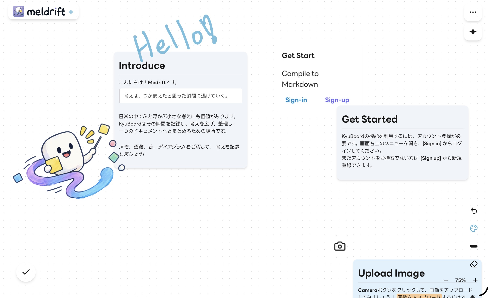
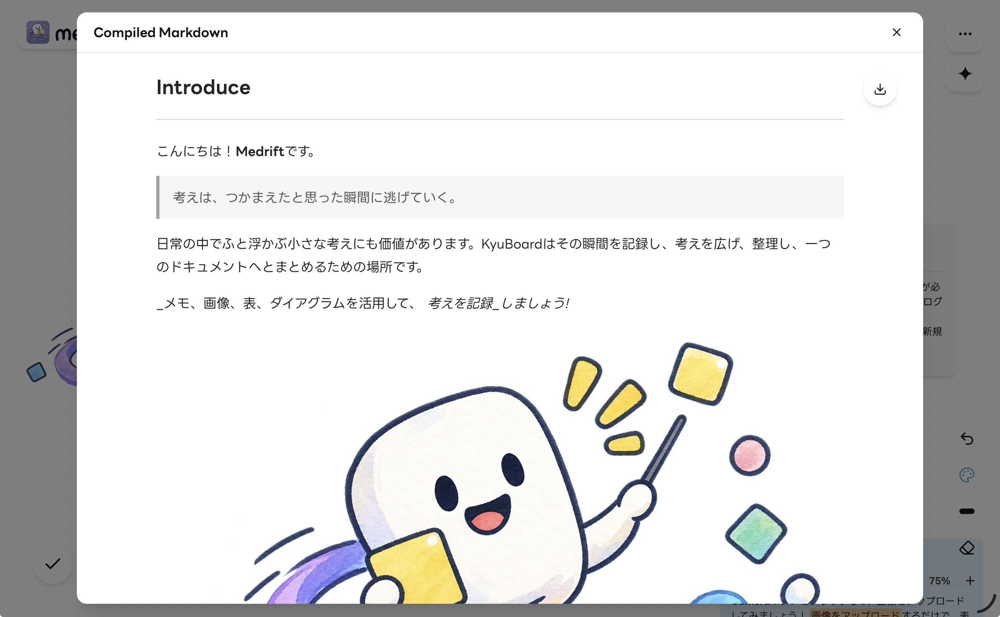

# Meldrift v1.3 Beta

Meldrift is a personal project for organizing ideas on a visual board and compiling them into Markdown documents.

## Concept

Ideas do not always begin in a clear order. Meldrift allows memos, images, tables, diagrams, and drawings to be placed freely before their contents are organized into a Markdown document.

## Features

- Create and manage multiple boards in Plus, or use a single local board in Free.
- Write rich text memo cards.
- Add image, Mermaid, and table cards.
- Drag and drop images onto the board while preserving transparent backgrounds.
- Choose Mermaid diagram types and edit them with contextual code completion, existing-node suggestions, and a hand-drawn rendering option.
- Edit table cells, manage rows and columns, and resize cards while keeping each row's minimum height.
- Move, resize, and change the layer order of cards.
- Select multiple cards to move or delete them together.
- Draw with a mouse, touch input, or Apple Pencil.
- Search memos and navigate through them in order.
- Reorder memos by dragging, which sets both the navigation sequence and the Markdown output order.
- Zoom and pan across the board.
- Pinch to zoom on touch devices.
- Undo and redo card and drawing changes, including Import and Reset, from the bottom-center toolbar.
- Use keyboard shortcuts to switch modes and create cards.
- Compile board contents into Markdown and download the result.
- Export and import SQLite save files containing the complete board and image data.
- Use an AI assistant to create, edit, delete, and arrange cards after reviewing its proposed changes.

## Structure

Meldrift is an npm workspace monorepo.

- `apps/free`: browser-storage edition served from `/`
- `apps/plus`: local-first edition with authentication and server synchronization, served from `/plus`
- `packages/core`: framework-free rules and schemas shared by both editions
- `packages/ui`: React components and hooks shared by both editions
- `packages/board-data`: board data, browser SQLite and IndexedDB storage, image processing, change tracking, and Markdown compilation
- `packages/ai`: the assistant body shared by both editions

Both editions use the same board editor and local storage flow. Free keeps its board in browser storage without requiring an account. Plus adds board management and Neon-based authentication, then synchronizes changed fields and new image assets after local saves. Cloudinary is used for Plus board previews; image cards are stored as binary data.

Undo/Redo history is kept in memory for the latest 50 operations and resets when the page is reloaded. Plus file export requires login, while Import and Reset also require editing permission.

The [design documents](docs/README.md) describe the shared editor, storage, and edition-specific behavior.

## Development

Meldrift is currently under development.
