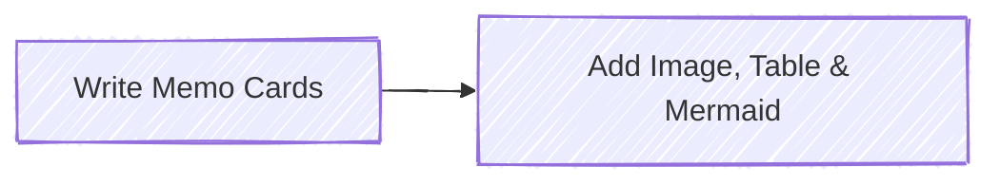
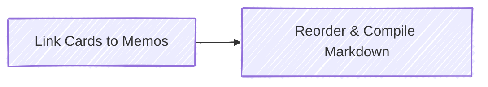

# Welcome to Meldrift!

Meldrift is a **spatial Markdown workspace** where you arrange drifting ideas on a freeform canvas, connect visual cards, and compile everything into a single clean Markdown document.

## How Meldrift Works

Start with a **Memo** for each section of your document. Add an Image, Table, or Mermaid card wherever a section needs more context.

For example, drag a comparison table within **50px** of a Memo corner. Meldrift attaches the table to that Memo so it appears in the same section when you compile the document.

## Card Types Overview

| Card | Purpose | How to Create | Compiled Markdown Output |
| --- | --- | --- | --- |
| **Memo** | Rich Markdown notes & document sections | Memo button or `m` | Ordered headings & body sections |
| **Image** | Visual screenshots & diagrams | Camera button, `i`, or drag & drop | Embedded asset (`./images/...` in ZIP) |
| **Table** | Structured grids & comparisons | Table button or `t` | GitHub-Flavored Markdown table |
| **Mermaid** | Flowcharts, sequences & architecture | Mermaid button or `d` | Fenced `mermaid` code block |

## 50px Spatial Linking & Compilation

Any **Image**, **Table**, or **Mermaid** card placed within **50px** of one of a Memo's four corners automatically attaches to that Memo:

| Spatial State | Visual Line | Included in Compile? |
| --- | --- | --- |
| Within `50px` (non-overlapping) | Black dashed connector | Yes |
| Within `50px` (overlapping Memo) | Hidden to reduce clutter | Yes |
| Beyond `50px` from all corners | None | Not attached to a Memo |

Open the top-right **`...`** menu to use **Reorder Memos** (change section order `#1`, `#2`, ...) and **Compile to Markdown** (preview and download `.md` or `.zip` with images).

> **Interactive Tutorial:** Closing this Help window opens **`Tutorial`**, **`Help`**, and **`Close (Esc)`** at the top of the canvas. Try **Tutorial** anytime to walk through every feature in an isolated sandbox without affecting your board.

## Meldrift+ Storage

With Meldrift+, your boards are saved to your account and synced to the server. Edits are kept in this browser first and sent to the server a few seconds later, so you can open the same board on other devices. Use **Export** in the **`...`** menu to save a `.sqlite` backup at any time.

## Syntax References

- [Markdown syntax](https://commonmark.org/help/)
- [Mermaid diagram syntax](https://mermaid.js.org/intro/syntax-reference.html)
