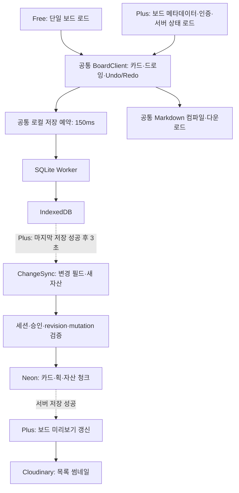

# Meldrift 기본설계서

버전: v1.3 Beta

작성 기준: 2026-10-14 현재 워크스페이스 구현

## 1. 목적과 범위

Meldrift는 캔버스 기반 Markdown 컴파일러를 만드는 개인 프로젝트다. 메모, 이미지, 표, Mermaid 다이어그램과 자유 드로잉을 보드에 배치하고, 메모 순서와 카드의 접점 관계를 Markdown 문서로 변환한다.

- 카드 생성·편집·이동·리사이즈·삭제와 레이어 변경.
- 다중 카드 선택, 일괄 이동·삭제.
- 메모 검색, 연번 탐색, 드래그로 문서 순서 변경.
- 마우스·터치·Apple Pencil 드로잉, 부분 지우개.
- 패닝·줌·터치 핀치 줌과 키보드 단축키.
- 카드와 드로잉의 Undo/Redo, SQLite 파일 Export·Import, 보드 Reset.
- Markdown 미리보기와 문서·이미지 파일 다운로드.
- 제안을 검토하고 저장·취소할 수 있는 AI 어시스턴트.
- Plus의 보드 목록·인증·인가·서버 동기화·목록 미리보기.

드로잉은 카드가 아닌 보드의 획 목록이다. Undo/Redo와 SQLite 반출입에는 포함하지만 Markdown 컴파일에는 포함하지 않는다.

## 2. 배포와 패키지

| 영역 | 역할 |
| --- | --- |
| `apps/free`, `/` | 단일 로컬 보드, 인증 없이 사용, Help·파일 반출입 |
| `apps/plus`, `/plus` | 여러 보드, 로그인·승인·관리자 기능, 서버 동기화·미리보기 |
| `packages/ui` | 공통 보드 화면, React 컴포넌트·훅, 폰트·전역 CSS |
| `packages/board-data` | 보드 상태·검증, SQLite·IndexedDB, 이미지 변환, 변경분 모델, Markdown 컴파일 |
| `packages/core` | 프레임워크 독립 카드·획·표·메모 순서·Mermaid 문법·AI 계획 규칙 |
| `packages/ai` | 서버 어시스턴트, 도구·프롬프트, AI 비밀번호 잠금 |

공통 편집 흐름은 `ui → board-data → core`다. 앱에는 초기 데이터 로드, 인증, 메뉴의 추가 항목과 저장 계층 연결을 남긴다. Free의 호스트가 Plus를 프록시하는 멀티존 구성으로 한 도메인의 `/plus`를 제공한다.

## 3. 기술 구성

| 영역 | 기술 |
| --- | --- |
| 화면 | Next.js App Router, React, TypeScript, Tailwind CSS |
| 카드·편집 | react-rnd, TipTap, CodeMirror 6, TanStack Table |
| 다이어그램 | Mermaid, ZenUML 플러그인 |
| 로컬 저장 | Web Worker의 SQLite WASM, IndexedDB의 SQLite 파일 |
| 서버 저장 | Neon PostgreSQL, Drizzle의 Neon HTTP 드라이버 |
| 이미지 | 브라우저 Canvas 압축, 바이너리·Blob URL |
| Markdown | Turndown, React Markdown, GFM, sanitize |
| 미리보기 | html-to-image, Canvas, Cloudinary |
| AI | Google Gen AI SDK, 함수 호출과 모델 폴백 |
| 검증 | Zod, Vitest, Testing Library, Playwright |

## 4. 전체 데이터 흐름

Free는 IndexedDB 저장에서 끝난다. Plus의 `delta` 보드는 전체 SQLite 파일 대신 변경분을 서버에 보낸다. 아직 전환되지 않은 `snapshot` 보드는 기존 전체 파일 업로드 경로를 유지한다. 두 경로를 현재 저장 방식과 호환 경로로 구분한다.

구조 그림은 [meldrift-structure.svg](./meldrift-structure.svg), 변경분의 상세 계약은 [change-sync.md](./plus/change-sync.md)에 있다.

## 5. 화면과 상태 소유권

공통 `BoardClient`가 카드 컬렉션, 편집 ID, 드로잉, 검색·탐색·정렬, 다중 선택, 뷰포트, 단축키, 이력을 연결한다. 앱별 `renderControls`가 메뉴·인증 모달·Help·저장·파일 반출입을 조립한다.

| 상태 | 소유자 |
| --- | --- |
| 카드 컬렉션·편집 ID | 카드 종류별 `useBoard*` 훅 |
| 카드 내부 내용·좌표·크기 초안 | 카드별 편집 훅 |
| 드로잉 획·색·굵기·도구 | `useBoardDrawing` |
| 현재 획·입력 포인터 | `useDrawingPointer` |
| 다중 선택·그룹 이동 | `useBoardSelection`, `useSelectionPointer` |
| 메모 순서·목록 드래그 | `useMemoReorder` |
| 검색·탐색 | `useBoardSearch`, `useBoardMemoFocus` |
| 줌·패닝·핀치 | `features/viewport`의 훅 |
| 과거·현재·미래 객체 상태 | `useBoardHistory` |
| 작업 중인 물리 포인터 | `useBoardPointerActive` |
| 로컬 저장 예약 | `useBoardPersistence` |
| Plus 원격 큐·revision·재시도 | `useBoardSnapshot`, `ChangeSync` 또는 `SnapshotSync` |

현재 화면의 `BoardSnapshot`은 보드 정보, 네 카드 컬렉션, 획 목록을 묶는다. 저장, 파일 반출입과 브라우저 Markdown 컴파일은 이 값을 입력으로 사용한다.

## 6. 좌표와 뷰포트

- 기본 보드는 7680 × 4320이다. 저장된 보드는 해당 보드의 크기를 사용한다.
- 카드의 위치·크기는 확대 전 보드 좌표이고 원점은 왼쪽 위다.
- 실제 스크롤 레이어, 확대된 크기 레이어, `transform: scale(zoom)`을 적용하는 논리 보드를 분리한다.
- `react-rnd`에도 같은 `zoom`을 전달하고 확정된 좌표·크기를 반올림한다.
- 핀치 중에는 DOM 변환과 스크롤 크기를 함께 갱신해 카드 전체의 매 프레임 React 렌더를 줄인다.
- 카드·입력·툴바·다이얼로그·드로잉 캡처 영역에서는 일반 패닝을 시작하지 않는다.
- 스크롤과 줌은 객체 이력에 넣지 않으며 Undo/Redo로 되돌리지 않는다.

## 7. 카드와 편집

| 카드 | 내용 | 기본 크기 | 최소 크기 |
| --- | --- | --- | --- |
| Memo | TipTap HTML, 배경색, `sortOrder` | 300 × 200 | 180 × 180 |
| Image | 이미지 바이너리, MIME, label, `assetId` | 비율 유지, 최대 400 × 300 | 48 × 48 |
| Mermaid | 문법 문자열 | 480 × 360 | 180 × 180 |
| Table | 열·행·셀을 가진 `TableSource` | 560 × 360 | 폭 360, 높이는 전체 행 수로 계산 |

메모·Mermaid·표는 임시 음수 ID로 만들고, 편집 완료 시 로컬 양수 ID로 확정한다. 이미지는 변환 완료 후 로컬 양수 ID로 추가한다. 서버 ID를 받기 위해 카드별 API를 호출하지 않는다. 서버 동기화는 불변 `syncId`로 식별한다.

더블 클릭·더블 탭으로 편집하고 빈 보드 클릭으로 내용을 확정한다. 한 번에 한 종류의 카드만 편집한다. 이동·리사이즈 종료는 `onGeometryChange`로 위치·크기만 공통 상태에 반영한다. 본문은 편집 완료까지 내부 초안으로 유지한다. 편집 중에는 영속 저장과 보드 Undo/Redo 실행을 막는다.

레이어 변경은 네 종류의 카드를 현재 z·종류·ID 순으로 정렬한 뒤 대상을 맨 앞 또는 뒤로 옮기고, 전체 z를 1부터 다시 매긴다. 초기 임시 카드도 레이어 버튼을 사용할 수 있다.

### 이미지

선택·드롭 파일은 브라우저에서 디코드하고 최대 1920px로 축소·압축한다. 현재 입력 제한은 25 MiB, 변환 후 바이트 제한은 5 MiB다. WebP를 우선 사용하고, WebP 인코더가 없으면 불투명 이미지는 JPEG, 투명 이미지는 PNG를 사용해 알파를 유지한다. 화면용 Blob URL은 저장값으로 쓰지 않는다.

### Mermaid

카드 상단 select로 다이어그램 종류를 고르고 CodeMirror 6에서 편집한다. 문맥에 따라 도형·연결선·기존 객체 등을 추천하며 실시간 SVG 미리보기와 손그림 스타일을 제공한다. 지원 목록과 템플릿은 `mermaid-language.ts`를 기준으로 한다. 렌더 ticket으로 오래된 결과를 버린다.

### 표

열 이름·셀·열 폭 편집, 행·열 추가와 삭제를 제공한다. 표는 카드 안의 가용 높이를 채우며 추가 버튼 영역은 흰색이다. 최소 높이는 `max(128, 49 + 40 + 5 + 행 수 × 37)`이고 Rnd 표시, 리사이즈 완료, 저장에서 같은 계산을 적용한다.

## 8. 선택·검색·메모 순서

선택 모드에서는 사각 영역으로 여러 카드를 고르고, 그룹을 보드 경계 안에서 함께 이동하거나 삭제한다. 그룹 작업은 하나의 이력으로 기록한다.

검색은 메모 내용의 대소문자 무시 부분 일치이며, 탐색 연번과 검색 결과 순회는 `sortOrder`, ID 순이다. `Reorder Memos` 패널은 손잡이 드래그를 놓을 때 순서를 확정한다. 이 순서가 Markdown 문서 순서이고, 카드의 좌표 이동은 문서 순서를 바꾸지 않는다.

검색과 탐색 패널은 하단 중앙의 같은 영역에서 상호 배타적으로 열린다. 선택·드로잉 모드 전환 시 두 패널과 보드 메뉴를 닫는다.

## 9. 드로잉

- 마우스·터치·Apple Pencil 입력을 받아 보드 전체 SVG에 획을 그린다.
- 펜 접촉 중 비펜 입력을 무시하고, 터치가 먼저 시작되면 펜에 입력 소유권을 넘긴다.
- 도구는 `draw`와 `erase`다. 별도의 드로잉 패닝 도구는 없고 모드를 끝내면 보드 패닝으로 돌아간다.
- 획 하나는 포인터 종료 시 확정한다. 지우개는 경로와 겹친 획 구간을 지우며 한 번의 입력을 하나의 이력으로 묶는다.
- 캡처 단계의 종료 감지로 레이어의 전파 차단, 보드 밖에서 끝난 입력, cancel·blur와 Pencil hover를 처리한다.
- 드로잉 툴바의 Undo도 공통 보드 Undo를 사용한다.
- 획 이력은 모드 안에서도 기록하지만 기존 영속 저장은 모드 종료 후 실행한다.

## 10. Undo/Redo

하단 중앙 `BoardHistoryToolbar`의 Undo2·Redo2 버튼으로 최근 50개 작업을 이동한다. 이력은 브라우저 메모리에만 있고 새로고침하면 사라진다.

메모·이미지·Mermaid·표·획 컬렉션만 기록한다. 내용, 위치·크기, z, 메모 순서, 생성·삭제를 복원하며 스크롤·줌·편집·선택·인증·서버 revision·전송 큐는 제외한다. 변경되지 않은 객체와 이미지 바이트는 참조를 공유하고 전체 파일이나 JSON을 복제하지 않는다.

편집 완료, 이동·리사이즈 종료, 그룹 작업, 획·지우개 입력 종료가 기록 단위다. 임시 카드와 AI 제안은 확정 전까지 기록을 보류한다. 복원은 새 작업으로 기록하지 않고 Undo 후 새 변경이 확정되면 Redo를 비운다.

복원 시 카드·드로잉을 `contentVersion`으로 재마운트하고 편집·선택·포커스를 정리한다. 보드·초기 서버 상태 교체와 계정 전환의 재마운트 시 이력을 초기화한다. 권한이 없거나 편집·포인터·이미지 변환·AI 처리 중이면 실행하지 않는다. 모달이 열린 상태도 실행을 막는다.

복원한 객체는 기존 저장 경로로 보내 새 변경으로 동기화한다. 원격 revision이나 전송 중 요청을 과거로 되돌리지 않는다. 상세: [board-history.md](./shared/board-history.md).

## 11. 키보드 단축키

| 키 | 기능 |
| --- | --- |
| `1` | 선택 ↔ 패닝 |
| `2` | 드로잉 ↔ 패닝 |
| `m` | 메모 생성 |
| `i` | 이미지 선택창 |
| `t` | 표 생성 |
| `d` | Mermaid 생성 |

선택과 드로잉은 동시에 켜지지 않는다. 입력창·편집·모달·열린 패널·IME 조합·키 반복·수정키 조합은 제외한다. 카드 생성은 툴바와 같은 조건으로 제한한다. Free의 Help는 별도로 Ctrl/⌘ + Shift + H다. 상세: [board-shortcuts.md](./shared/board-shortcuts.md).

## 12. 저장·반출입·Reset

공통 `useBoardPersistence`는 추가 변경이 없는 150ms 후 로컬 저장을 요청한다. 편집·드로잉·AI 제안 중에는 저장을 보류하고 실패는 보드 메시지로 표시한다. SQLite 파일과 Plus의 outbox는 IndexedDB에 함께 보존한다.

Plus의 `delta` 보드는 마지막 로컬 저장 성공 후 3초에 변경분을 전송한다. 진행 중 묶음은 고정하고 추가 편집은 다음 묶음으로 남긴다. 세션·승인·보드 소속·필드·revision·mutation을 검증하고 트랜잭션으로 반영한다. 새 이미지와 큰 변경 본문은 1 MiB 청크로 올린다. 좌표·크기 변경에는 이미지 바이트를 넣지 않는다.

두 Edition 모두 이미지 바이트를 포함한 `.sqlite` 파일 Export·Import와 Reset을 제공한다. Plus는 로그인 후 Export가 가능하고 Import·Reset에는 편집 권한도 필요하다. Import는 보드 메타데이터를 유지하면서 내용을 교체하고, Reset은 내용만 비운다. 둘 다 확인을 거치고 하나의 Undo 작업으로 기록하며 페이지를 새로고침하지 않는다.

서버 저장 실패는 로컬 데이터를 지우지 않는다. 세션·충돌 등 영구 오류는 업로드를 막고 로컬 백업 다운로드, 서버 상태 복원, Reload를 제공한다. 로컬 저장과 원격 저장의 완료를 구분한다. 호환 경로의 4 MiB 스냅샷 한도를 `delta` 보드 전체 용량 한도로 설명하지 않는다.

## 13. 인증·보드 목록·미리보기

Plus 로그인은 난수 토큰, 서버의 SHA-256 토큰 해시·만료 시각, HttpOnly 쿠키를 사용한다. 같은 계정의 새 로그인은 이전 세션을 무효화한다. 현재 서버는 탭 리스가 아니라 살아 있는 세션과 승인 상태를 저장 시 검증한다.

관리자는 보드를 생성·이름 변경·삭제한다. 서버 보드 페이지는 메타데이터만 조회하고, 잘못된 ID·존재하지 않는 보드는 Next.js 404로 처리한다. 카드 내용은 클라이언트가 저장 모드에 따라 로드한다.

Plus 목록은 정적 WebP 미리보기를 표시한다. 서버 저장 성공 후 현재 뷰포트 캡처를 예약하고, Cloudinary의 고정 경로를 덮어쓴다. `preview_version`으로 캐시 URL을 갱신한다. 보드 삭제는 서버 관련 행과 구버전 Cloudinary 이미지·목록 미리보기를 명시적으로 정리한다. 카드 이미지의 신규 저장소는 Cloudinary가 아닌 Neon 자산 청크다.

## 14. Markdown 컴파일

두 Edition의 화면은 현재 로컬 스냅샷을 같은 공통 함수로 컴파일한다. 메모를 `sortOrder`, ID 순으로 읽고 각 메모의 네 꼭짓점을 엄격히 포함하는 이미지·Mermaid·표 중 z가 가장 높은 카드를 붙인다. 중복 첨부는 한 번만 출력한다.

메모 HTML은 Markdown, Mermaid는 fenced code block, 표는 GFM 표, 이미지는 이미지 링크로 변환한다. 로컬 이미지가 있으면 PNG 자산과 문서를 ZIP으로, 없으면 `.md`로 내려받는다. 드로잉은 포함하지 않는다.

미리보기는 Mermaid 섹션을 순차 스캔해 분리하고 나머지는 GFM·sanitize로 렌더링한다. 중첩된 정규식 split으로 긴 입력을 처리하지 않는다. 서버 Markdown API는 `delta`, 스냅샷, 구버전 카드 저장 순서로 해당 저장 모드를 읽는다.

## 15. AI 어시스턴트

공통 패널과 서버 어시스턴트를 사용한다. AI 비밀번호 잠금은 두 Edition에 적용하며 Plus에는 계정 편집 권한도 필요하다. API 키와 비밀번호는 서버에만 둔다.

지원 도구는 생성·재배치·내용 수정·삭제다. 논리 계획을 검증한 뒤 좌표는 공통 배치 규칙으로 계산한다. 생성은 메모와 첨부 카드, 내용 수정은 메모·Mermaid·표, 삭제는 네 카드 종류를 지원한다. 기존 이미지 내용 수정·재배치는 지원하지 않는다.

사용자는 제안을 검토하고 저장 또는 취소한다. 수락된 객체 상태는 로컬 저장과 Plus 동기화로 넘어가며 카드별 서버 INSERT/PATCH를 호출하지 않는다. 보류 중에는 영속 저장과 보드 이력 실행을 막는다.

## 16. 검증과 문서

Vitest로 공통 규칙·이력·큐·저장·권한·API를, Playwright로 실제 SQLite·IndexedDB·화면 복원·이미지·서버 동기화를 검증한다. Undo/Redo의 50단계 제한, 참조 공유, 새 변경 시 Redo 제거, 전체 객체와 Import·Reset 복원, revision 증가와 이미지 미재전송을 포함한다.

브라우저 테스트의 Plus 쓰기는 테스트 서버로 가로채고 Neon의 보드 메타데이터만 읽는다. PR·수동 CI는 lint, 타입 검사, 단위 테스트, 양쪽 build와 E2E를 실행한다. 자세한 실행법은 [playwright-testing.md](./playwright-testing.md)에 있다.

- [공통 BoardClient](./shared/board-client.md)
- [보드 이력](./shared/board-history.md), [단축키](./shared/board-shortcuts.md)
- [브라우저 DB](./shared/browser-database.md), [보드 상태](./shared/board-state.md)
- [Plus 변경분 동기화](./plus/change-sync.md), [호환 스냅샷](./plus/board-snapshot.md)
- [Free 반출입](./free/board-transfer.md), [Markdown](./shared/markdown-export.md)
