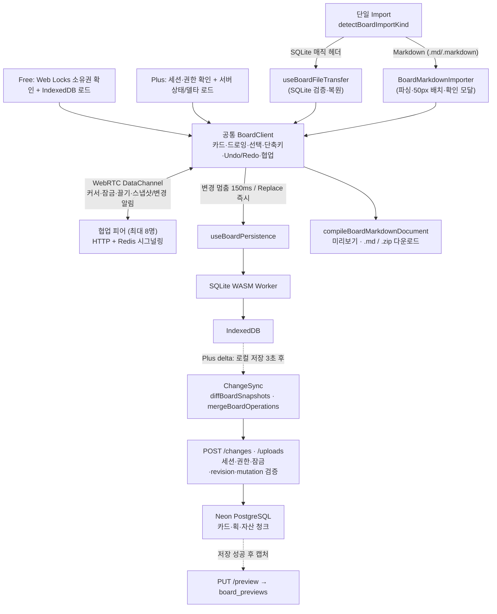

# Meldrift 기본설계서

- **버전**: v2.0
- **작성 기준**: 2026-11-25 현재 워크스페이스 구현 (`feature/live-board`)
- **대상 범위**: Free Edition (`apps/free`), Plus Edition (`apps/plus`), 공유 패키지 4종 (`packages/core`, `packages/board-data`, `packages/ui`, `packages/ai`)

---

## 1. 목적과 제품 개요

Meldrift는 **공간적 캔버스 편집**과 **선형 Markdown 문서 입출력**을 연결하는 웹 기반 워크스페이스다. 메모·이미지·표·Mermaid 다이어그램·자유 드로잉을 무한에 가까운 2D 보드(`7680 × 4320`)에 자유롭게 배치한 뒤, 메모의 논리 순서(`sortOrder`)와 50px 꼭짓점 접점 규칙(`cornerLinkRadius`)을 통해 단일 Markdown 문서(`.md` 또는 이미지 포함 `.zip`)로 컴파일하며, 반대로 기존 Markdown 파일을 불러와 헤딩별 메모 카드와 표·Mermaid 카드로 자동 변환·배치한다.

### 핵심 기능 요약

| 분류 | 주요 기능 |
| --- | --- |
| **카드 4종** | Memo(실시간 Markdown 서식·8색 팔레트), Image(로컬/드롭 WebP 압축·알파 보존), Table(스프레드시트형 그리드·Excel/Sheets TSV 복붙), Mermaid(34종 다이어그램·시각 편집 + 코드 편집) |
| **캔버스 조작** | 패닝·줌·터치 핀치 줌, 다중 카드 선택(일괄 이동·삭제), Z-레이어 변경, 자유 드로잉(마우스·터치·Apple Pencil) 및 부분 지우개, 최근 50단계 Undo/Redo |
| **문서화 (양방향)** | `50px` 코너 연결 시각화(`BoardCornerLinksLayer`), 메모 검색·연번 탐색·드래그 순서 변경(`Reorder Memos`), **Markdown 컴파일/미리보기/다운로드**, **단일 Import(SQLite / Markdown 자동 분기)** |
| **실시간 협업 (v2.0)** | **P2P WebRTC DataChannel** 기반 실시간 협업 — 접속자·실시간 커서·카드 잠금·끌기 미리보기·원격 패치 (Free 초대형 최대 8명 / Plus 협업 보드 자동 입장·호스트 승계) |
| **온보딩 · AI** | 2탭 Help 모달(`Introduce` · `Short-cut`), 격리 샌드박스 6단계 인터랙티브 튜토리얼, Gemini Function Calling 기반 보드 생성·수정·재배치·삭제 AI 어시스턴트 |
| **Plus 멀티보드 · 권한** | 계정 로그인(단일 활성 세션), 관리자 승인(`permission_flg`), 보드 공개 범위(`private_flg`), 멤버 공유(`board_members`: `editor`/`viewer`), 델타 동기화, PostgreSQL 미리보기 |

> 드로잉은 카드가 아닌 보드의 획(`strokes`) 목록이다. Undo/Redo, SQLite 반출입, Plus 동기화, 실시간 협업에는 포함하지만 Markdown 컴파일에는 포함하지 않는다.

---

## 2. 모노레포 구조와 배포 구성

```text
Meldrift (npm workspace monorepo)
├─ apps/free            / (브라우저 SQLite·IndexedDB, 무인증, 사용자 호스트 P2P Live, Plus 멀티존 프록시)
├─ apps/plus            /plus (멀티 보드, 인증·권한, Neon PostgreSQL 델타 동기화, 자동 P2P Live)
├─ packages/ui          공통 React 보드 화면, 4종 카드·드로잉·선택·뷰포트·이력·협업·Help·튜토리얼·Markdown 임포터
├─ packages/board-data  보드 스냅샷·검증, SQLite WASM Worker·IndexedDB, 델타·원격 패치, 이미지 처리, Markdown 컴파일·임포트
├─ packages/core        프레임워크 독립 도메인 규칙 (카드·50px 연결 기하·획·표·메모 순서·AI 배치 계획·WebRTC 직접 연결)
└─ packages/ai          서버 Gemini 어시스턴트, Function Calling 도구 정의, 패스코드 해시·쓰로틀링
```

### 의존 방향과 앱 경계

- 공유 패키지 의존 방향은 **`ui → board-data → core`** 및 **`ai → core`**의 단방향을 유지한다.
- 두 Edition은 동일한 공통 `BoardClient`(`packages/ui/src/features/board/BoardClient.tsx`)를 사용한다.
- `apps/free`와 `apps/plus`에는 초기 데이터 로드, 탭 소유권/인증·권한, 저장소 어댑터(`BoardStorage`), Live 시그널링 API·런타임, 메뉴 래퍼(`renderMenu`)만 남긴다.
- 배포는 `apps/free`의 Next.js `rewrites`가 `/plus`와 `/plus/*`(및 `/plus` Referer의 `/api/*`)를 `apps/plus` 오리진으로 프록시하는 **단일 도메인 멀티존** 구성을 지원한다.

---

## 3. 기술 스택

| 영역 | 사용 기술 및 버전 |
| --- | --- |
| **프레임워크 · 언어** | Next.js App Router, React 19, TypeScript 7, Tailwind CSS 4 |
| **자체 편집 엔진** | `@meldrift/markdown-engine` (Typora형 실시간 Markdown 에디터 + `compileMarkdown`), `@meldrift/table-engine` (그리드/TSV 편집), `@meldrift/diagram-engine` (Mermaid 12·ZenUML 34종 렌더러 + CodeMirror 6) |
| **카드 인터랙션** | `react-rnd` (보드 좌표 이동·리사이즈), `lucide-react` 아이콘 |
| **로컬 저장소** | Web Worker + `@sqlite.org/sqlite-wasm` (SQLite3 WASM), 브라우저 IndexedDB, Web Locks API (Free 탭 쓰기 소유권) |
| **서버 저장소 (Plus)** | Neon PostgreSQL, Drizzle ORM (`drizzle-orm/neon-http`), PostgreSQL `bytea` 청크/미리보기 저장 |
| **실시간 협업** | WebRTC `RTCPeerConnection` / `RTCDataChannel` (STUN 전용, 무 TURN), Vercel HTTP + Redis (`Upstash Redis REST` / `redis`) 시그널링·잠금 |
| **Markdown 파이프라인** | `turndown` (HTML → MD Export), `@meldrift/markdown-engine` `compileMarkdown` (MD → Safe HTML Import), `react-markdown` + `remark-gfm` + `rehype-raw` + `rehype-sanitize` |
| **이미지 · 미리보기** | 브라우저 Canvas WebP/JPEG/PNG 변환, `html-to-image` (Plus 뷰포트 캡처 → `board_previews` 저장, 구 공개 보드 Cloudinary 폴백) |
| **AI 어시스턴트** | `@google/genai` (`3.3.0`), Gemini Function Calling + 모델 폴백 |
| **검증 · 테스트** | `zod` 4, `vitest` 5, `@testing-library/react`, `@playwright/test`, `@electric-sql/pglite` (Plus Live E2E) |

---

## 4. 전체 시스템 데이터 흐름



---

## 5. 화면 구조와 상태 소유권

`BoardClient`는 **일반 보드**와 **튜토리얼 샌드박스**를 상호 배타적으로 전환하는 진입점이고, 실제 보드 화면 본체는 `BoardWorkspace`가 조립한다.

### 주요 상태 소유권

| 상태 / 책임 | 담당 모듈 | 위치 |
| --- | --- | --- |
| 카드 4종 컬렉션 · 현재 편집 ID | `useBoardMemos`, `useBoardImages`, `useBoardMermaids`, `useBoardTables` | `packages/ui/src/features/*` |
| 카드별 편집 초안 · 좌표 · 삭제 확인 | `useMemoCard`, `useImageCard`, `useMermaidCard`, `useTableCard` | `packages/ui/src/features/*` |
| Z-레이어 정렬 · 맨 앞/맨 뒤 | `useCardLayer` | `packages/ui/src/features/board/` |
| 드로잉 획 · 지우개 · 포인터 캡처 | `useBoardDrawing`, `useDrawingPointer` | `packages/ui/src/features/drawing/` |
| 사각 다중 선택 · 그룹 이동/삭제 | `useBoardSelection`, `useSelectionPointer` | `packages/ui/src/features/selection/` |
| 메모 검색 · 연번 탐색 · 순서 변경 | `useBoardSearch`, `useBoardMemoFocus`, `useMemoReorder` | `packages/ui/src/features/board/`, `memo/` |
| 보드 줌 · 패닝 · 터치 핀치 | `useBoardZoom`, `useBoardScroll`, `useBoardPinchZoom` | `packages/ui/src/features/viewport/` |
| 최근 50단계 객체 이력 | `useBoardHistory` | `packages/ui/src/features/board/` |
| 물리 포인터 활성 추적 · 단축키 | `useBoardPointerActive`, `useBoardShortcuts` | `packages/ui/src/features/board/` |
| 로컬 저장 예약 · 즉시 플러시 | `useBoardPersistence` | `packages/ui/src/features/board/` |
| SQLite Export · Import · Reset | `useBoardFileTransfer` | `packages/ui/src/features/board/` |
| 파일 포맷 분기 · Markdown 임포트 | `detectBoardImportKind`, `BoardMarkdownImporter` | `packages/ui/src/features/board/`, `markdown/` |
| 실시간 협업 커서 · 잠금 · 원격 패치 | `useBoardCollaboration`, `CollaborationLayer`, `PresenceBar` | `packages/ui/src/features/collaboration/` |
| Help 모달 · 캔버스 런처 · 튜토리얼 | `HelpOverlay`, `HelpModal`, `HelpCanvasMenu`, `TutorialGuide` | `packages/ui/src/features/guide/` |
| AI 어시스턴트 채팅 · 제안 미리보기 | `useAiAssistant`, `AiChatPanel`, `AiUnlockPanel` | `packages/ui/src/features/ai/` |
| Plus 서버 델타/스냅샷 동기화 | `useBoardSync`, `ChangeSync`, `SnapshotSync` | `apps/plus/hooks/`, `lib/` |
| Free 탭 쓰기 소유권 · P2P 호스트/게스트 | `useBoardLoad` (Web Locks), `useHostRoom`, `usePeerEditor`, `useRoomStorage` | `apps/free/hooks/` |

### `savePaused` 가드와 권한 통제

- `savePaused = isEditing || drawingMode || hasPendingAiCards`
  - 카드 편집 중, 드로잉 모드 활성 중, AI 제안 검토 중에는 영속 저장·Export·Import·Reset·Undo/Redo 실행을 차단한다.
- 모든 편집 진입점(카드 생성·수정·드롭·순서 변경·Undo/Redo·AI 실행)은 `BoardWorkspace`의 단일 `canEdit` 가드를 통과한다.

---

## 6. 좌표계, 뷰포트 및 50px 코너 연결

- **논리 보드 크기**: 기본 `7680 × 4320` (원점 좌상단). 카드 좌표(`x`, `y`, `width`, `height`)는 줌 전 보드 좌표 기준 정수 반올림 값이다.
- **3단 레이어 구조**: `board-scroll-layer`(스크롤 뷰포트) → `board-size-layer`(`boardWidth × zoom`, `boardHeight × zoom`) → `meldrift-board`(`transform: scale(zoom)`).
- **핀치 줌 최적화**: 터치 핀치 중에는 DOM 변환과 스크롤을 동기 갱신해 React 매 프레임 리렌더를 줄인다. 스크롤·줌은 Undo 이력에 포함하지 않는다.
- **50px 코너 연결(`cornerLinkRadius = 50`)**:
  - `resolveMemoCornerLinks`([cards.ts](./shared/core.md))가 모든 메모의 네 꼭짓점(`TL → TR → BL → BR`)에서 반경 `50px` 이내(점과 카드 사각형 간 최단 거리 `<= 50px`)에 있는 Image·Mermaid·Table 중 `z` 내림차순 → `cardTypeOrder`(`image < mermaid < table`) → `id` 오름차순으로 최상위 1장을 선택한다.
  - 한 카드는 문서 전체에서 최초 매칭된 메모 1곳에만 연결된다.
  - 연결된 카드가 메모와 **겹치지 않으면** `BoardCornerLinksLayer`가 메모 꼭짓점과 카드 최단 경계점(`getCardCornerAnchor`) 사이에 검은 점선 연결선을 표시한다. 겹쳐 있으면 화면 복잡도를 줄이기 위해 점선만 숨기고 컴파일 연결은 유지한다.

---

## 7. 카드 4종 상세 사양

| 카드 | 저장 데이터 | 기본 크기 | 최소 크기 | 핵심 편집 기능 |
| --- | --- | --- | --- | --- |
| **Memo** | HTML(`content`), 배경색(`color`, 8종 팔레트), `sortOrder` | `300 × 200` | `180 × 180` | `@meldrift/markdown-engine` Typora형 실시간 Markdown 입력, 제목 `H1`~`H6`, 목록·체크리스트·인용·코드블록·구분선·하이라이트·취소선·링크, 툴바 서식 토글 |
| **Image** | 바이너리(`Uint8Array`), `mimeType`, `label`, `assetId` | 비율 유지, 최대 `400 × 300` | `48 × 48` | 파일 선택·드래그 앤 드롭(`BoardImageDropOverlay`), 입력 최대 `25 MiB` → 긴 변 `1920px` 이하 · 최대 `5 MiB` 압축 (WebP 우선, 미지원 시 불투명 JPEG / 투명 PNG 알파 보존) |
| **Mermaid** | 문법 문자열(`source`, 노드 좌표 `%% meldrift-layout` 포함) | `480 × 360` | `180 × 180` | `@meldrift/diagram-engine` 34종 다이어그램 템플릿, 문맥 자동완성, 손그림 스타일, 도형 팔레트, 시각적 노드 드래그/연결/이름·화살표 편집, SVG 자동 맞춤(`fitDiagramBounds`) + Rnd 배율 조절 |
| **Table** | `TableSource` (`columns`, `rows`, 열 너비·행 높이) | `560 × 360` | 폭: 열 수 기반, 높이: `max(128, 94 + Σ 행높이)` | `@meldrift/table-engine` 셀 선택·범위 편집, 열 이름 편집, 행·열 추가/삭제/이동, 열 너비·행 높이 조절(하한 `37px`), Excel/Google Sheets TSV 복사·붙여넣기 |

### 카드 공통 수명주기와 패널 배치

- Memo·Mermaid·Table은 생성 시 임시 음수 ID(`-Date.now()`)로 편집 모드에 진입하고, 빈 보드 클릭(포인터 시작·종료 모두 빈 보드) 또는 닫기 버튼으로 로컬 양수 ID를 부여해 확정한다. 서버 동기화·협업은 불변 UUID `syncId`로 식별한다.
- **Mermaid 편집 패널 반응형 배치**:
  - 데스크톱·태블릿(`>= 768px`): 좌측 고정 패널(에디터 + 도형 팔레트 + 최소화 토글; 최소화 시 엔진 인스턴스·커서 유지).
  - 모바일(`< 768px`): `document.body` 포탈 하단 고정 패널(최대 높이 `45%`, 팔레트 숨김, 우측 `80px`·하단 `80px` + safe-area 확보).
- **레이어 변경**: 네 카드 종류 전체를 현재 `(z, cardTypeOrder, id)`로 정렬해 대상을 맨 앞(`front`) 또는 맨 뒤(`back`)로 옮기고 `z = 1..N`으로 재할당한다. 편집 중인 카드는 `ACTIVE_CARD_Z = 49999`로 최상단에 오른다.

---

## 8. 선택 · 검색 · 탐색 · 메모 순서 · 드로잉

- **다중 선택**: 모드 `1`에서 사각 드래그로 4종 카드를 복수 선택하고 보드 경계 내에서 일괄 이동·일괄 삭제한다. 일괄 작업은 Undo 이력 1건으로 기록된다.
- **검색 · 연번 탐색**: 하단 중앙 동일 슬롯에서 상호 배타적으로 열린다. 검색은 메모 본문 대소문자 무시 부분 일치이며, 탐색 연번과 검색 순회는 `(sortOrder, id)` 순서를 따른다.
- **메모 순서(`Reorder Memos`)**: 좌상단 `MemoReorderPanel`에서 드래그 핸들로 순서를 재배치하면 탐색 연번과 Markdown 컴파일 순서가 즉시 갱신된다.
- **드로잉**: 모드 `2`에서 보드 전체 SVG 레이어에 `draw` / `erase` 도구로 획을 그린다. Apple Pencil 접촉 시 비펜 터치를 무시하며, 지우개는 경로와 교차한 획을 한 번의 입력 단위로 묶어 삭제·이력 기록한다.

---

## 9. Undo / Redo 이력 설계

- 하단 중앙 `BoardHistoryToolbar`에서 최근 **50단계** 객체 이력을 탐색한다(브라우저 메모리 보관, 새로고침 시 초기화).
- **기록 대상**: `memos`, `images`, `mermaids`, `tables`, `strokes` 컬렉션만 기록한다. 변경되지 않은 객체와 이미지 바이트는 참조를 공유한다.
- **기록 단위**: 카드 생성/편집 확정, 이동/리사이즈 종료, 그룹 이동/삭제, 레이어/순서 변경, 획·지우개 입력 종료, AI 제안 수락, Import(SQLite/Markdown), Reset.
- **복원 처리**: `contentVersion` 증가로 카드·드로잉을 재마운트하고, 복원 결과는 새 로컬 변경으로 취급해 기존 저장·동기화 경로를 그대로 탄다. 실시간 협업 중에는 원격 패치를 기존 이력에 투영해 타인의 변경을 되돌리지 않게 보호한다.

---

## 10. 전체 키보드 단축키 사양

실제 구현된 모든 단축키는 **전역/다이얼로그**, **캔버스**, **메모 Markdown 에디터**, **표 카드 그리드**의 4개 컨텍스트로 나뉜다.

### 10.1 전역 및 다이얼로그

| 단축키 | 동작 | 비고 |
| --- | --- | --- |
| `Ctrl + Shift + P` (Win/Linux)<br>`Cmd + Shift + P` (macOS) | Help 모달 열기 | `window` 캡처 단계 리스너(`useHelpShortcut`). 메모 편집 중에도 동작 |
| `Esc` | 활성 모달·메뉴·오버레이 닫기 | Help 모달, About 모달, Markdown 미리보기, `HelpCanvasMenu`, Mermaid 선택 해제 |

### 10.2 캔버스 모드 및 카드 생성 (`useBoardShortcuts`)

> 입력 요소(`input`, `textarea`, `select`, `[contenteditable]`, `.cm-editor`), 모달(`[aria-modal="true"]`, `dialog[open]`), 키 반복(`repeat`), IME 조합 중(`isComposing` / `keyCode === 229`), 수정키 동시 입력 시 자동 차단된다.

| 키 | 동작 | 제약 |
| --- | --- | --- |
| `1` | 선택 모드 ↔ 패닝 모드 토글 | 드로잉 모드가 켜져 있으면 끄고 전환 |
| `2` | 드로잉 모드 ↔ 패닝 모드 토글 | 선택 모드가 켜져 있으면 끄고 전환 |
| `m` | 메모 카드 생성 | 드로잉·다중 선택 중 비활성, `canEdit` 필요 |
| `i` | 이미지 업로드 선택창 열기 | 드로잉·다중 선택 중 비활성, `canEdit` 필요 |
| `t` | 표 카드 생성 | 드로잉·다중 선택 중 비활성, `canEdit` 필요 |
| `d` | Mermaid 다이어그램 카드 생성 | 드로잉·다중 선택 중 비활성, `canEdit` 필요 |

### 10.3 메모 Markdown 에디터 (`@meldrift/markdown-engine`)

메모 카드 내부 편집 시 활성된다.

#### 인라인 서식

| 동작 | macOS | Windows / Linux |
| --- | --- | --- |
| 굵게 (Bold) | `Cmd + B` | `Ctrl + B` |
| 기울임 (Italic) | `Cmd + I` | `Ctrl + I` |
| 밑줄 (Underline) | `Cmd + U` | `Ctrl + U` |
| 링크 삽입/편집 | `Cmd + K` | `Ctrl + K` |
| 하이라이트 (Highlight) | `Cmd + Shift + H` | `Ctrl + Shift + H` |
| 인라인 코드 | ``Cmd + Shift + ` `` 또는 ``Ctrl + ` `` | ``Ctrl + Shift + ` `` |
| 취소선 (Strikethrough) | ``Ctrl + Shift + ` `` | `Alt + Shift + 5` |
| 서식 지우기 | `Cmd + \` | `Ctrl + \` |
| 에디터 실행 취소 / 다시 실행 | `Cmd + Z` / `Cmd + Shift + Z` | `Ctrl + Z` / `Ctrl + Shift + Z` |

#### 제목 · 목록 · 블록

| 동작 | macOS | Windows / Linux |
| --- | --- | --- |
| 제목 1 ~ 6 (`H1`~`H6`) | `Cmd + 1`..`6`, `Ctrl + 1`..`6` 또는 `Cmd + Option + 1`..`6` | `Ctrl + 1`..`6` 또는 `Ctrl + Alt + 1`..`6` |
| 일반 문단 (`P`) | `Cmd + 0`, `Ctrl + 0` 또는 `Cmd + Option + 0` | `Ctrl + 0` 또는 `Ctrl + Alt + 0` |
| 제목 단계 올리기 / 내리기 | `Cmd + =` / `Cmd + -` | `Ctrl + =` / `Ctrl + -` |
| 인용문 (Blockquote) | `Cmd + Option + Q` | `Ctrl + Shift + Q` |
| 코드 블록 (Code Block) | `Cmd + Option + C` | `Ctrl + Shift + K` |
| 순서 있는 목록 (`OL`) | `Cmd + Option + O` | `Ctrl + Shift + [` |
| 순서 없는 목록 (`UL`) | `Cmd + Option + U` | `Ctrl + Shift + ]` |
| 체크리스트 (Task List) | `Cmd + Option + X` | `Ctrl + Shift + X` |
| 구분선 (`HR`) | `Cmd + Option + -` | `Ctrl + Shift + -` |
| 목록 들여쓰기 / 내어쓰기 | `Tab` / `Shift + Tab` (`Cmd + ]` / `[`) | `Tab` / `Shift + Tab` (`Ctrl + ]` / `[`) |
| 줄바꿈 (`<br>`) | `Shift + Enter` | `Shift + Enter` |
| 인용/코드/구분자 빠져나오기 | `Esc` | `Esc` |

### 10.4 표 카드 그리드 (`@meldrift/table-engine`)

표 카드 편집 시 활성된다.

| 단축키 | 동작 |
| --- | --- |
| `방향키 (Arrow)` | 셀 포커스 이동 (`Cmd/Ctrl` 끝으로 이동, `Shift` 범위 확장) |
| `Tab` / `Shift + Tab` | 다음 / 이전 셀 이동 (현재 셀 편집 확정) |
| `Home` / `End` | 행 시작 / 끝 이동 (`Cmd/Ctrl` 조합 시 전체 첫/마지막 셀) |
| `Enter` 또는 `F2` | 포커스된 셀 편집 진입 (`Enter`는 확정 후 아래 셀 이동) |
| `Alt + Enter` | 셀 내부 줄바꿈 삽입 |
| `Esc` | 셀 편집 취소 또는 다중 선택 해제 |
| `Delete` / `Backspace` | 선택된 셀 내용 비우기 |
| `Cmd + A` / `Ctrl + A` | 전체 셀 선택 |
| `Cmd/Ctrl + C` / `X` / `V` | 선택 셀 복사 · 잘라내기 · 붙여넣기 (TSV 포맷, Excel/Sheets 호환) |

### 10.5 Mermaid 다이어그램 캔버스 (`@meldrift/diagram-engine`)

Mermaid 카드 편집 중 다이어그램 캔버스에서 노드·화살표를 선택한 상태에서 활성된다.

| 단축키 | 동작 |
| --- | --- |
| `Enter` | 선택한 노드·화살표 텍스트 인라인 편집 시작 (편집 중 `Enter` 확정) |
| `Delete` / `Backspace` | 선택한 노드·화살표 삭제 |
| `Esc` | 인라인 편집 취소 또는 노드·화살표 선택 해제 |

---

## 11. 저장 · 반출입 · 동기화 · Reset

### 11.1 로컬 저장과 Free 탭 쓰기 소유권

- 공통 `useBoardPersistence`가 변경 종료 **150ms** 후 Web Worker의 SQLite WASM에 보드 전체를 기록하고 IndexedDB에 저장한다.
- **Free 탭 소유권(`useBoardLoad`)**: 브라우저의 Web Locks API(`navigator.locks.request("meldrift-free:edit")`, 300ms 타임아웃)로 동일 브라우저 내 쓰기 주체를 탭 1개로 제한한다. 이미 다른 탭이 편집 중이면 후속 탭은 읽기 전용(`ownsBoard = false`)으로 열린다.

### 11.2 Plus 서버 델타 동기화 (`ChangeSync`)

- Plus `delta` 보드는 마지막 로컬 저장 성공 **3초** 후 `diffBoardSnapshots`와 `mergeBoardOperations`로 변경 필드·획·새 자산만 추출해 `POST /api/boards/[boardId]/changes`로 전송한다.
- 새 이미지와 대용량 자산은 **1 MiB 청크**(`/uploads` → `/chunks/[index]` → `/complete`)로 분리 업로드하며, 좌표·크기 변경 시 이미지 바이트를 재전송하지 않는다.
- `mutation_id` 멱등성 키와 `revision` 낙관적 락, `touched` 키 충돌 검사로 동시 충돌(409)을 감지하며, 영구 오류 시에도 로컬 데이터를 지우지 않고 백업 다운로드·서버 복원·Reload를 제공한다.
- 미전환 `snapshot` 보드는 기존 전체 파일 호환 경로(`/snapshot`)를 유지하고 `/transition`으로 `delta` 모드로 일회성 전환할 수 있다.

### 11.3 단일 `Import` 분기 · Export · Reset

- 보드 메뉴(`...`)의 단일 `Import` 버튼과 단일 `<input type="file" aria-label="Import board database">`로 **SQLite(`.sqlite`)**와 **Markdown(`.md`, `.markdown`, `.mdown`, `.mkd`)**을 모두 선택한다.
- `BoardControls`는 `detectBoardImportKind`로 파일 앞 16바이트의 SQLite 매직 헤더(`"SQLite format 3\0"`)를 우선 확인한 뒤 확장자·MIME을 판별해 책임을 완전히 분리한다:
  - **SQLite** → `useBoardFileTransfer.importSqliteFile(file)` (최대 50 MiB, 무결성·스키마 검증, `window.confirm`, 교체 후 즉시 저장).
  - **Markdown** → 별도 전담 컴포넌트 `<BoardMarkdownImporter />` (최대 2 MiB, UTF-8 디코딩, `importMarkdownToBoard`, 기존 콘텐츠가 있으면 변환 요약 `ConfirmDialog`, 빈 보드는 즉시 적용, 교체 후 즉시 저장).
- `Export`는 대기 중 저장을 먼저 플러시한 뒤 이미지 바이너리가 포함된 `.sqlite` 파일을 내려받는다. `Reset`은 `ConfirmDialog` 확인 후 보드 내용만 비운다. Import·Reset 모두 새로고침 없이 동작하며 단일 Undo 작업으로 기록된다.

---

## 12. Markdown 컴파일(Export) 및 임포트(Import)

### 12.1 컴파일 (`compileBoardMarkdownDocument`)

1. `sortMemosByOrder`로 메모를 `(sortOrder, id)` 순으로 순회한다.
2. 각 메모의 HTML을 Turndown(`atx` 헤딩, `-` 목록, `fenced` 코드 블록, `~~취소선~~` 규칙)으로 변환한다.
3. 메모의 네 꼭짓점을 **`TL → TR → BL → BR`** 순으로 스캔해 반경 `50px` 이내 최상위 카드(Image/Mermaid/Table)를 출력한다(문서당 카드 1회 중복 방지).
4. 브라우저에서는 Markdown과 연결된 로컬 이미지 자산을 ZIP으로 내려받는다. Plus 서버는 `GET /api/boards/[boardId]/markdown`으로 저장된 보드의 Markdown을 제공한다.
5. 컴파일 화면은 메모·첨부를 선형으로 편집할 수 있다. 초안은 편집기와 캔버스에 표시되며 `Apply`에서 보드에 반영한다. 이미지 준비 중에는 적용을 기다린다. 자세한 동작은 [Markdown 상세설계](./shared/markdown-export.md)를 참고한다.

### 12.2 임포트 (`importMarkdownToBoard`)

`packages/board-data/src/board-markdown-import.ts`의 순수 파이프라인으로 동작한다.

1. **라인 기반 순차 스캐너(`parseMarkdownToSections`)**:
   - 펜스 코드 블록(`` ``` `` / `~~~`) 상태를 추적해 코드 블록 안의 `#`이나 `| --- |`를 오탐하지 않는다.
   - 펜스 밖의 ATX 헤딩(`#` ~ `######`)마다 새 메모 섹션을 시작하고 등장 순서대로 `sortOrder = 1..N`을 부여한다(첫 헤딩 이전 본문은 선행 메모 `#1`).
   - GFM 파이프 표(헤더 + 구분선 + 0..N행)를 `TableSource`로 추출해 `tableSourceSchema`로 검증한다(`\|`, `<br>` 언이스케이프, 불균일 열 정규화, 최대 20열 × 100행).
   - 언어 태그가 `mermaid`인 닫힌 펜스 블록을 Mermaid 카드로 추출한다(일반 코드 블록은 메모 본문에 유지).
2. **HTML 변환 및 XSS 방어**: 남은 메모 Markdown은 `@meldrift/markdown-engine`의 `compileMarkdown()`으로 변환해 모든 원시 HTML 태그를 이스케이프한다.
3. **50px 코너 연결 자동 배치**:
   - 한 섹션의 첨부(1~4개)를 `TR` / `TR·BR` / `TR·BL·BR` / `TL·TR·BL·BR` 슬롯에 `24px` 간격(`<= 50px`, 비겹침)으로 배치해 `Compile to Markdown` 라운드트립 시 **원본 순서를 100% 보존**한다.
   - 첨부가 5개 이상인 섹션은 4개 단위로 연속 메모 카드(`<제목> (2)`)를 자동 생성해 모든 카드를 연결한다(전체 섹션 상한 100개).
   - 섹션 간 세로·열 간격은 `80px`(`> 50px`)을 보장해 인접 메모와의 오연결을 차단한다.

---

## 13. 실시간 협업 (P2P Live Collaboration)

두 Edition 모두 **WebRTC DataChannel(STUN 직접 연결, 무 TURN)** 기반의 호스트 권위형 스타 토폴로지(호스트 1 + 참가자 최대 7 = **총 8명**)로 실시간 협업을 제공한다. Vercel 장기 WebSocket 인스턴스 비용과 TURN 중계 비용을 제거하고, HTTP + Redis는 짧은 시그널링(입장·SDP/ICE 교환·Plus 잠금)만 담당한다.

| 구분 | Free 사용자 호스트 Live | Plus 협업 보드 자동 Live |
| --- | --- | --- |
| **진입 방식** | 보드 메뉴 `Start collaboration` → 초대 링크(`/live/join/[roomId]#k=<128bit키>`) 복사. 참가자 브라우저가 프래그먼트 키를 읽어 주소창에서 즉시 제거 | 협업 보드(`boards.collab_flg = 1`, `delta` 모드)를 로그인 상태로 열면 기존 주소(`/plus/boards/[boardId]`)에서 자동 입장 |
| **호스트 · 승인** | 방을 연 데스크톱 브라우저가 호스트. 참가 요청을 `편집 허용` / `보기만` / `거절`로 수동 승인 | 첫 편집 권한자(소유자·`editor` 멤버)를 자동 호스트 선출. 호스트 퇴장 시 남은 편집자가 새 `epoch`로 자동 승계 |
| **정원 · 수명** | 최대 8명, 방 수명 최대 8시간, 끊김 시 30초 자리 보류(`sessionStorage` 토큰 재접속), 하트비트 20초 | 최대 8명, 자리 갱신 25초 TTL(평시 5초 `pulse`), 60초 서명 토큰(45초마다 권한 재검증), 10분 무입력 시 `idle` 해제 |
| **원본 저장소** | 호스트가 순서를 확정해 호스트의 Free IndexedDB SQLite에 저장. 참가자는 격리 공간(`meldrift-free:peer:<roomId>:<participantId>`) 사용 및 `.sqlite` 백업 가능 | 편집자 본인이 `POST /changes`로 Neon PostgreSQL에 커밋. 참가자는 WebRTC 갱신 알림 후 `GET /changes?after=R`로 동기화 |
| **잠금 · 장애 대응** | 호스트가 메모리 잠금·순서 판정. 공유 방 중 Import·Reset·AI 비활성 | Redis HASH 키 잠금(`memo:<syncId>`, `order:memo`, `layer:strokes`, `board:*`, TTL 20초, Lua 원자 처리). 10초 미연결 시 일반 클라우드 편집(`unavailable`) 대체 |
| **시그널링 저장소** | 개발: 메모리 / 운영: `PEER_LIVE_REDIS_REST_URL` + `PEER_LIVE_REDIS_REST_TOKEN` (Upstash REST) | 개발: 메모리 / 운영: `REDIS_URL` (`LIVE_ENABLED=true`, `LIVE_TOKEN_SECRET`) |

공통 UI 계층(`packages/ui/src/features/collaboration`)은 `BoardCollaboration` 계약만으로 접속자 바(`PresenceBar`), 실시간 커서·사용자 색 잠금 테두리·`"이름 · editing"` 칩·끌기 점선 윤곽(`CollaborationLayer`), 미확정 로컬 변경 미루기(`deferKeys`)와 원격 패치 적용(`packages/board-data/src/remote-patch.ts`)을 동일하게 렌더링한다.

---

## 14. 인증 · 권한 · 데이터베이스 · API 구조 (Plus & Free)

### 14.1 인증 및 보드 권한 모델 (Plus)

- **세션**: 난수 세션 토큰의 SHA-256 해시와 만료 시각을 `users` 테이블에 저장하고 HttpOnly 쿠키로 전달한다. 동일 계정의 새 로그인은 이전 세션을 무효화한다(계정당 활성 세션 1개).
- **관리자 승인**: 신규 가입자는 `permission_flg = false`로 생성되며, 관리자가 `MemberManagementModal`(`/api/members`)에서 승인·권한을 관리한다.
- **보드 공개 범위 & 멤버십**: `boards.private_flg`(0: 공개, 1: 비공개)와 `board_members(board_id, user_id, role: 'editor' | 'viewer')` 조합으로 3단계 권한을 판정한다:
  - `canReadBoard`: 공개 보드 ∨ 관리자 ∨ 소유자 ∨ 멤버
  - `canEditBoard`: 관리자 ∨ (승인됨 ∧ (소유자 ∨ `editor` 멤버))
  - `canManageBoard`: 관리자 ∨ (승인됨 ∧ 소유자) — 이름·공개 범위·협업 모드 변경, 멤버 공유(`ShareBoardModal`), 삭제
- **목록 미리보기**: 서버 저장 성공 후 뷰포트를 캡처해 `PUT /api/boards/[boardId]/preview`(최대 4 MiB PNG/WebP)로 PostgreSQL `board_previews` 테이블에 저장한다. `GET`은 `board_previews`를 우선 응답하고, 없는 구 공개 보드만 `preview_version` 기반 Cloudinary 경로로 폴백한다.

### 14.2 주요 PostgreSQL 테이블 (`docs/DB/schema.sql`)

| 그룹 | 테이블 | 역할 |
| --- | --- | --- |
| **계정 · 권한** | `users`, `boards`, `board_members`, `board_previews` | 계정·세션·역할, 보드 메타데이터(`private_flg`, `collab_flg`), 공유 멤버십, 미리보기 `bytea` |
| **보드 콘텐츠** | `memos`, `images`, `mermaids`, `tables`, `drawing_strokes`, `drawings` | 보드별 카드(`(board_id, sync_id)` 유니크) 및 드로잉 획 |
| **동기화 · 자산** | `board_sync`, `sync_mutations`, `assets`, `asset_chunks`, `upload_sessions`, `board_snapshots` | 모드(`snapshot`/`migrating`/`delta`)·판 번호, 멱등 변경 로그, 1 MiB 자산 청크, 호환 스냅샷 |

### 14.3 주요 App Router 및 API 라우트

| 앱 | 라우트 그룹 | 주요 경로 |
| --- | --- | --- |
| **Free** | 페이지 | `/`, `/live/join/[roomId]` |
| **Free** | P2P Live API | `/api/peer-live/rooms`, `/rooms/[roomId]`, `/rooms/[roomId]/join`, `/rooms/[roomId]/exchange` |
| **Free** | AI API | `/api/ai/status`, `/api/ai/unlock`, `/api/ai/chat` |
| **Plus** | 페이지 | `/`, `/boards/[boardId]` |
| **Plus** | 인증 · 멤버 | `/api/signup`, `/api/signin`, `/api/signout`, `/api/me`, `/api/members` |
| **Plus** | 보드 · 동기화 | `/api/boards`, `/boards/[boardId]`, `/state`, `/changes`, `/transition`, `/snapshot`, `/snapshot/images/[imageId]`, `/preview`, `/markdown`, `/members` |
| **Plus** | 자산 청크 업로드 | `/boards/[boardId]/uploads`, `/uploads/[uploadId]`, `/uploads/[uploadId]/chunks/[index]`, `/uploads/[uploadId]/complete`, `/assets/[assetId]`, `/assets/[assetId]/bytes`, `/assets/[assetId]/chunks/[index]` |
| **Plus** | Live · AI · Cron | `/boards/[boardId]/live/token`, `/boards/[boardId]/live`, `/api/ai/*`, `/api/cron/sync-mutations` |

---

## 15. 온보딩 (Help · 튜토리얼) 및 AI 어시스턴트

### 15.1 2탭 Help 모달 & 6단계 인터랙티브 튜토리얼

- **Help 모달(`HelpModal`)**: 빈 보드 첫 진입 시 자동 오픈 또는 전역 단축키 `Ctrl/⌘ + Shift + P`로 열린다. `Introduce`(개념·Mermaid 흐름도·카드 표·50px 연결 설명·스크린샷)와 `Short-cut`(전체 단축키 레퍼런스) 2개 탭을 지연 `fetch` + 캐시(`AbortController`)로 로드한다.
- **캔버스 퀵 런처(`HelpCanvasMenu`)**: Help 모달을 닫으면 `Tutorial` / `Help` / `Close (Esc)` 바가 표시된다. `z-49999`에 위치하며 보드 메뉴·메모 순서 패널·카드 편집·Markdown 미리보기가 열리면 자동으로 숨겨진다.
- **6단계 격리 샌드박스 튜토리얼(`TutorialBoardClient`)**: 개인 보드 저장소(`IndexedDB`/서버)를 전혀 건드리지 않는 독립 샌드박스에서 ① 메모 생성·편집 → ② Table·Mermaid 생성 → ③ 쇼케이스 자동 배치(메모 2 + 마스코트 이미지 + 표 + Mermaid) → ④ 50px 코너 연결 반경 SVG 시각화 → ⑤ Markdown 컴파일·다운로드(미리보기 위 `z-60002` 하단 가이드) → ⑥ 메모 순서 변경 후 재컴파일을 패딩 글로우 강조(`meldriftTutorialPaddingGlow`)와 함께 체험한다.

### 15.2 AI 어시스턴트 (`@meldrift/ai`)

- 서버 전용 API 키(`AI_API_KEY`)와 비밀번호(`AI_PASSWORD`, HttpOnly 서명 쿠키 + 실패 횟수 제한)로 보호되며, Plus에서는 편집 권한도 함께 검사한다.
- `@google/genai` SDK로 Function Calling 4종 도구(`create`, `rearrange`, `edit`, `delete`)를 호출한다. 모델은 `GEMINI_MODEL` 우선, 미지정/429·503 시 `gemini-3.6-flash` → `gemini-3.5-flash` → `gemini-3.7-flash` → `gemini-flash-latest` 순으로 폴백한다.
- 배치 알고리즘(`board-plan.ts`)은 `column`, `grid`, `tree`, `scatter` 4종 모드를 지원하며, 모든 제안은 검토 후 수락(저장·이력 반영) 또는 취소할 수 있다.

---

## 16. 환경변수 · 검증 전략 · 상세 문서 색인

### 16.1 주요 환경변수

| 대상 | 변수 | 용도 |
| --- | --- | --- |
| 공통 AI | `AI_API_KEY`, `AI_PASSWORD`, `GEMINI_MODEL` | Gemini API 키, 어시스턴트 잠금 비밀번호, 우선 모델 지정 |
| Free Live | `PEER_LIVE_REDIS_REST_URL`, `PEER_LIVE_REDIS_REST_TOKEN`, `PEER_LIVE_ENABLED`, `NEXT_PUBLIC_PEER_LIVE_STUN_URLS` | Upstash Redis REST 시그널링, 기능 토글, STUN 서버 목록 |
| Plus DB · 인증 | `DATABASE_URL`, `SESSION_SECRET`, `CRON_SECRET` | Neon PostgreSQL 연결, 세션 서명, `sync_mutations` 정리 Cron 인증 |
| Plus Live | `LIVE_ENABLED`, `REDIS_URL`, `LIVE_TOKEN_SECRET`, `LIVE_ALLOWED_ORIGINS` | 자동 P2P Live 활성화, 방/잠금 Redis, 서명 토큰 비밀값, 허용 출처 |
| 멀티존 · 레거시 | `PLUS_ORIGIN`, `CLOUDINARY_*` | Free→Plus 프록시 대상 오리진, 구 공개 보드 이미지/미리보기 호환 |

### 16.2 테스트 및 CI

- **단위 테스트 (`npm test`)**: 6개 워크스페이스 Vitest 실행 (`meldrift-free`, `meldrift-plus`, `@meldrift/ui`, `@meldrift/core`, `@meldrift/ai`, `@meldrift/board-data`).
- **정적 검증 (`npm run typecheck`, `npm run lint`)**: Free·Plus 양쪽 `tsc --noEmit` 및 `eslint`.
- **브라우저 E2E**:
  - Free/Plus 일반 E2E: Playwright로 `desktop-chromium`, `mobile-safari`(iPhone 15), `tablet-safari`(iPad Pro 11) 3개 프로젝트 검증.
  - Plus Live E2E (`npm run test:e2e:live --workspace=meldrift-plus`): PGlite + 실제 HTTP 라우트로 자동 입장, 호스트 선출·승계, 잠금, 지속 저장 검증.

### 16.3 상세 설계 문서 색인

- **공통 (`docs/shared/`)**: [BoardClient](./shared/board-client.md), [BoardControls](./shared/board-controls.md), [보드 이력](./shared/board-history.md), [단축키](./shared/board-shortcuts.md), [다중 선택](./shared/board-selection.md), [브라우저 DB](./shared/browser-database.md), [보드 상태](./shared/board-state.md), [Mermaid 카드](./shared/mermaid-card.md), [Table 카드](./shared/table-card.md), [Image 카드](./shared/image-card.md), [Markdown 컴파일](./shared/markdown-export.md), [Markdown 임포트](./shared/markdown-import.md), [Help 모달](./shared/help-modal.md), [인터랙티브 튜토리얼](./shared/interactive-tutorial.md), [AI 코어](./shared/assistant-core.md)
- **실시간 협업**: [P2P Live 설계 (Free & Plus)](./p2p-live-collaboration.md), [Plus Live 자동 P2P](./plus/live-collaboration.md)
- **Plus (`docs/plus/`)**: [변경분 동기화](./plus/change-sync.md), [호환 스냅샷](./plus/board-snapshot.md), [인증](./plus/authentication.md), [API 라우트](./plus/api-routes.md), [DB 스키마](./DB/schema.sql)
- **테스트 가이드**: [playwright-testing.md](./playwright-testing.md)
