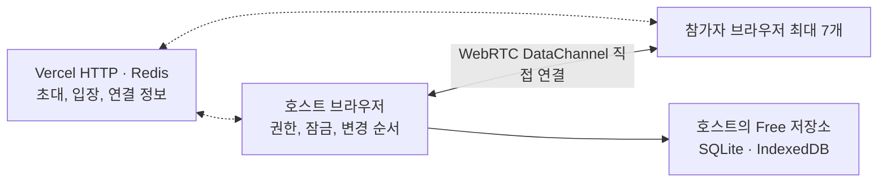

# 멜드리프트 사용자 호스트 Live 요구사항과 설계

2026-11-25 · Free 초대형 Live와 Plus 자동 입장 구현

## Free 구현

Free 보드 메뉴의 **Start collaboration**에서 방을 열고, **Invitation link**로 참가자를 초대한다. 호스트는 각 요청을 편집 또는 보기 전용으로 승인한다. 호스트의 확정본은 Free의 기존 저장소에 기록된다. 참가자는 방의 확정본을 탭에서 보고, 필요하면 SQLite 파일로 내려받는다. 게스트의 개인 보드는 별도의 경로와 저장소를 사용한다.

시그널링은 [방 서비스](../apps/free/lib/peer-live/signaling/rooms.ts)가 맡고, WebRTC와 청크 전송은 [전송 계층](../apps/free/lib/peer-live/transport/)에 둔다. [보드 확정 규칙](../apps/free/lib/peer-live/board/authority.ts)은 호스트의 저장 성공 후 변경을 알린다. 브라우저를 다시 연결할 때는 호스트에서 최신 확정판을 받으며 새 연결의 제안 번호는 다시 시작한다. 초기 구현에서는 양쪽이 ICE 후보를 모아 SDP 한 건에 담는다.

개발 서버는 기본으로 메모리 시그널링을 사용한다. 운영에서는 `PEER_LIVE_REDIS_REST_URL`과 `PEER_LIVE_REDIS_REST_TOKEN`을 Free 프로젝트에 서버 전용으로 설정하면 메뉴가 표시된다. 운영 Redis는 협업 시그널링 전용 권한으로 연결한다. `PEER_LIVE_ENABLED=false`로 메뉴와 API를 끌 수 있다. `NEXT_PUBLIC_PEER_LIVE_STUN_URLS`로 STUN 주소 목록을 설정할 수 있다. [Upstash Redis REST API](https://upstash.com/docs/redis/features/restapi)

로컬 검증에서는 Chromium 호스트와 참가자 7명이 연결되어 이미지를 받았고, 아홉 번째 입장은 거절됐다. HTTPS 프록시와 기본 STUN 설정으로 iPad 크기의 WebKit 참가자가 터치로 편집한 내용도 호스트의 새로고침 뒤에 남았다. Tailscale로 시험할 때는 참가자도 열 수 있는 개발 서버 HTTPS 주소에서 초대 링크를 발급한다. 실제 iPad, 서로 다른 외부 네트워크, 운영 Redis에서의 검증은 출시 단계에 남아 있다.

Plus의 기존 보드 주소를 통한 자동 입장과 호스트 교체는 9절에 정리한다.

## 1. 검토 결과

**Free에서도 구현할 수 있다.** 공유를 시작한 사람의 데스크톱 브라우저가 호스트가 되고, 최대 7명의 참가자가 각자 브라우저에서 접속한다. WebRTC DataChannel로 보드와 이미지, 편집 변경분을 직접 교환한다. 호스트가 편집 순서를 확정하고 기존 Free 저장소에 결과를 기록한다. 8명 제한에는 호스트와 보기 전용 참가자도 포함한다.

초대 URL로 바로 참여하려면 두 브라우저가 연결 정보를 교환할 곳이 필요하다. Vercel의 짧은 HTTP 요청과 만료되는 Redis 저장소로 이 교환을 처리한다. 이 역할을 **시그널링**이라고 한다. 보드·이미지·커서의 전송은 직접 연결에서 이루어지므로 해당 데이터의 Vercel WebSocket 사용량과 TURN 중계 요금은 발생하지 않는다. HTTP 호출과 Redis 사용량은 남으며, Plus는 Neon 저장 비용도 별도로 남는다. 절감액은 동일한 이용량으로 비교한 뒤 판단한다. [WebRTC 연결 가이드](https://webrtc.org/getting-started/peer-connections) · [Vercel WebSocket 과금](https://vercel.com/docs/functions/websockets#limits-and-pricing)

공유기나 방화벽 때문에 직접 연결이 성립하지 않는 환경이 있다. 첫 버전에서는 이런 연결을 실패로 처리하고 다른 네트워크에서 다시 시도할 수 있게 한다. 공동 편집은 호스트 탭이 실행되는 동안 가능하다. 이 조건을 받아들일 수 있는지와 실제 연결 성공률이 공개 여부를 결정한다. [WebRTC TURN 가이드](https://webrtc.org/getting-started/turn-server) · [브라우저 페이지 생명주기](https://developer.chrome.com/docs/web-platform/page-lifecycle-api)

### 현재 구조와 재사용 범위

| 영역 | 현재 | 사용자 호스트 Live에서 활용할 부분 |
| --- | --- | --- |
| 화면 | Free와 Plus가 같은 보드 편집기를 쓰고, Plus가 `BoardCollaboration`을 전달한다. | 접속자, 커서, 카드 잠금, 끌기 미리보기, 원격 패치 UI를 연결한다. 이메일 중심 표시는 표시 이름을 받을 수 있게 한다. [공통 계약](../packages/ui/src/features/collaboration/types.ts) |
| 변경분 | `BoardOperation`, `syncId`, `touchedKeysOf`, 원격 패치가 공유 패키지에 있다. | 같은 객체 식별과 변경분을 쓴다. 호스트가 받을 입력은 브라우저에서도 쓸 수 있는 검증기로 검사한다. [변경분](../packages/board-data/src/board-delta.ts) · [패치](../packages/board-data/src/remote-patch.ts) |
| Free 저장 | 브라우저 워커가 `meldrift-free`의 보드 하나를 SQLite로 만들고 IndexedDB에 저장한다. | 호스트의 최종 보드는 같은 저장소에 기록한다. 초대 페이지의 보드와 작성 중인 변경은 참가자 개인 보드와 다른 저장 공간을 쓴다. [Free 저장](./free/board-client.md) · [브라우저 DB](./shared/browser-database.md) |
| Plus Live | 로그인한 사용자가 기존 협업 보드를 열면 호스트를 자동으로 선출한다. | WebRTC는 커서·미리보기·갱신 신호를 전송한다. HTTP·Redis는 입장과 잠금을 맡고, Neon이 변경을 저장한다. [Plus Live](./plus/live-collaboration.md) · [변경분 동기화](./plus/change-sync.md) |

## 2. 기능 요구사항

| ID | 요구사항 | 완료 조건 |
| --- | --- | --- |
| F1 | Free 보드 메뉴에서 `협업 시작`을 누르면 현재 보드를 공유하는 방과 초대 URL이 생성된다. | 호스트와 참가자 모두 멜드리프트 로그인이나 별도 프로그램 설치 없이 사용할 수 있다. 공유 전 현재 보드 전체가 참가자에게 제공된다고 안내한다. |
| F2 | 초대 URL을 열면 표시 이름을 입력하고 참여를 요청한다. 호스트가 `편집 허용`, `보기만`, `거절` 중 하나를 선택한다. | 승인된 연결만 보드를 받는다. 보기 전용 참가자의 변경·잠금 요청은 호스트에서도 거절한다. 호스트는 참가자의 연결을 끊거나 초대 URL을 다시 발급할 수 있다. |
| F3 | 방 하나에 동시에 최대 8명이 들어간다. | 호스트 1자리와 참가자 최대 7자리다. 승인 대기·연결 중·재접속 유예도 자리를 점유한다. 여덟 번째 참가자 요청은 정원 초과로 거절한다. |
| F4 | 승인된 참가자는 메모·이미지·표·Mermaid·드로잉을 호스트 보드와 같은 상태로 본다. | 초기 데이터를 모두 검증한 다음 편집을 연다. 서로 다른 카드는 동시에 편집할 수 있고, 편집 중인 카드는 다른 참가자에게 잠김으로 보인다. |
| F5 | 보드에서 접속자·커서·카드 잠금·끌기 위치를 확인할 수 있다. | 편집을 완료한 변경은 새로고침 없이 반영된다. 같은 메모의 문자 단위 공동 편집은 카드 잠금 방식의 후속 과제로 둔다. |
| F6 | 호스트가 승인한 변경을 자기 보드로 저장하고, 참가자는 참여 중인 보드를 별도로 볼 수 있다. | 저장 성공으로 표시한 상태는 호스트가 새로고침해도 남는다. 초대 URL을 열거나 방을 나가도 참가자의 기존 Free 보드는 덮어쓰지 않는다. 참가자는 방의 확정본을 별도 세이브 파일로 내보낼 수 있다. |
| F7 | 재접속, 만료, 정원 초과, 호스트 종료, 직접 연결 실패를 구분해 표시한다. | 연결이 끊기면 편집을 잠그고 마지막 확정본을 표시한다. 같은 방에 재접속하면 최신 상태를 적용한 뒤 편집을 연다. 호스트 탭이 닫히면 방은 종료되고, 호스트는 저장된 내용으로 새 방을 열 수 있다. |
| F8 | 방 통신은 HTTPS 페이지에서 시작하고 직접 WebRTC 연결을 쓴다. | 별도 네트워크 설정 없이 직접 연결이 되는 환경에서 동작한다. 연결 실패 시 TURN이나 Vercel WebSocket으로 전환하지 않는다. |

**1차 지원 환경**은 데스크톱 Chrome·Edge·Safari의 호스트와 참가자, iPad Safari 참가자다. 실제 iPad와 서로 다른 네트워크에서 검증한 조합부터 지원한다. 한 호스트 탭에 한 방을 열고 최대 8시간 뒤 만료한다. 보드 전체를 바꾸는 Import·Reset과 외부로 보드 문맥을 보내는 AI 기능은 방을 닫은 개인 보드에서 사용한다. 클라우드에 상시 열려 있는 보드는 기존 Plus의 기능이다.

## 3. 전체 구조

참가자끼리 모두 연결하면 8명이 28개의 연결을 관리한다. 멜드리프트는 방을 시작한 브라우저가 각 참가자와 한 개씩 연결하는 구조를 쓴다. 최대 연결 수는 7개다. 참가자가 편집하면 호스트가 판정하고 각 참가자에게 같은 변경을 보낸다. 브라우저가 WebRTC 연결을 협상하므로 참가자는 초대 URL과 지원 브라우저로 참여한다.

| 위치 | 관리하는 데이터 |
| --- | --- |
| 시그널링 서버 | 방 ID, 방 실행 ID(`epoch`), 초대/호스트/참가자 토큰 해시, 입장 상태와 대기 중 표시 이름, `offer`·`answer`와 ICE 후보, 만료 시각 |
| Free 호스트 | 확정된 보드와 이미지, 방의 `revision`, 최근 변경 기록, 참가자 권한·잠금, 요청 중복 처리 기록 |
| Free 참가자 | 그 방의 마지막 확정 상태·자산, 내가 아직 확정받지 못한 변경, 화면 상태 |

### 적용 위치

Free 보드에서 방을 시작하고, `/live/join/[roomId]`는 별도 참가 화면으로 연다. Free의 브라우저 런타임이 연결·호스트 상태를 관리하고 공유 편집기에 `BoardCollaboration`과 방용 `BoardStorage`를 넘긴다. 참가 화면의 편집 가능 여부는 승인·연결·초기 동기화가 모두 끝났을 때만 참으로 둔다. 일반 Free 화면은 개인 보드 저장 흐름을 사용한다. [Free 보드 진입점](../apps/free/components/BoardClient.tsx)

Free 브라우저와 Plus 서버에서 같이 쓰는 변경분 검증은 `packages/board-data`에 둔다. WebRTC의 ICE 설정과 SDP 협상은 `packages/core/src/direct-webrtc.ts`에서 공유하고, 채널별 메시지는 각 앱에서 정한다. 공유 보드 UI는 전송 방식과 서버 종류를 모른 채 접속자·잠금·원격 패치를 받는다. [공통 편집기](../packages/ui/src/features/board/BoardWorkspace.tsx) · [Plus 변경 검증](../apps/plus/lib/sync-operations.ts)

## 4. 초대, 정원과 시그널링

### 초대와 접속 순서

1. 호스트는 개인 보드의 미완료 편집을 먼저 마무리한다. 브라우저 저장 성공을 확인하고 공유할 스냅샷을 고정한 뒤 방을 연다. 첫 상태는 `revision = 0`이다.
2. 서버가 추측하기 어려운 방 ID와 `epoch`, 방 관리 토큰과 초대 키를 발급한다. 호스트는 `/live/join/<roomId>#k=<inviteSecret>` 형태의 주소를 복사한다. 초대 키는 128비트 이상의 난수로 만들고 호스트 관리 토큰은 별도 난수로 발급한다.
3. 링크를 연 참가자는 표시 이름을 입력한다. 페이지는 프래그먼트의 키를 읽어 주소 표시줄에서 지우고, 입장 API 요청의 인증 값으로 보낸다. 서버가 초대 키·만료·정원을 검사하고 `participantId`와 참가자 전용 토큰을 발급해 자리를 예약한다. 토큰의 범위는 해당 방·참가자로 한정한다.
4. 호스트가 그 요청을 승인하면 호스트만 `offer`를 만든다. 참가자가 `answer`를 보내고 양쪽이 ICE 후보를 교환한다. ICE 설정에는 STUN만 제공한다. SDP와 개별 후보의 `relay` 후보는 사용하지 않는다. 서버는 참가자별로 목적지를 고정하고, 후보가 상대 SDP보다 일찍 도착하면 적용할 순서까지 기다린다.
5. DataChannel이 열리면 양쪽이 `epoch`, `participantId`, 연결 시도 ID와 프로토콜 버전을 확인한다. 호스트는 해당 연결의 승인 상태와 역할을 검사한 뒤에만 보드를 전송한다. 참가자가 자기 메시지에 호스트나 다른 참가자의 ID를 써도 연결에 기록된 발신자를 사용한다. [WebRTC 시그널링·ICE](https://webrtc.org/getting-started/peer-connections)

### HTTP API 계약 초안

Free의 `apps/free/app/api/peer-live/`에 아래 역할을 둔다. 기존 `/plus` 프록시와 경로를 분리한다. 모든 응답은 `no-store`다. 토큰은 요청 헤더로 전달하고, 브라우저는 같은 출처에서 요청한다.

| 메서드와 경로 | 호출 권한 | 처리 |
| --- | --- | --- |
| `POST /api/peer-live/rooms` | 호스트, 생성 빈도 제한 적용 | 방을 만들고 `roomId`, `epoch`, `hostToken`, 초대 키, 만료를 반환한다. |
| `POST /api/peer-live/rooms/:id/join` | 초대 키 또는 기존 참가자의 방 토큰 | 새 자리를 예약하거나 기존 참가자의 자리를 재사용한다. `participantId`, 참가자 토큰, `attemptId`를 반환하거나 갱신한다. |
| `POST /api/peer-live/rooms/:id/exchange` | 호스트 토큰 또는 참가자 토큰 | 입장 판정과 시그널 메시지를 보낸다. 마지막으로 받은 이벤트 번호 이후의 자기 수신함만 읽는다. 호스트 요청은 참가자 자리 상태와 방의 서버 만료도 갱신한다. |
| `PATCH /api/peer-live/rooms/:id` | 호스트 토큰 | 초대 키를 교체하거나 참가자 권한을 철회한다. 키 교체 뒤에 새로 참여하려면 새 링크가 필요하다. 참가자 권한을 철회하면 호스트가 해당 채널을 닫고 서버가 참가자 토큰을 무효화한다. |
| `DELETE /api/peer-live/rooms/:id` | 호스트 토큰 | 입장을 닫고 시그널링 데이터와 토큰 검증 자료를 정리한다. |

Redis에는 별도 키 영역을 두고 방마다 토큰 해시, 자리 상태와 양쪽 수신함을 관리한다. Free 시그널링이 사용할 권한은 이 키 영역으로 제한한다. 자리 예약·만료 제거·승인/철회는 같은 방에 대한 원자 작업으로 실행한다. 수신함은 `attemptId`로 분리하고, 이벤트 순번과 요청 ID로 재시도 시 중복을 막는다. 호스트는 참가자 연결·이탈·재접속 유예 상태를 다음 `exchange`에 함께 보낸다. 연결 정보 요청은 본문 64 KiB, SDP 메시지 32 KiB를 초기 상한으로 둔다. 협상이 끝나거나 시도가 만료되면 SDP와 후보를 지운다. [Redis 원자 스크립트](https://redis.io/docs/latest/interact/programmability/eval-intro/) · [Redis TTL](https://redis.io/docs/latest/commands/expire/)

| 항목 | 초기 제안값과 동작 |
| --- | --- |
| 정원 | Free는 브라우저의 참가 세션을 한 자리로 센다. 서버는 `예약 + 협상 + 동기화 + 접속 + 재접속 유예` 상태를 합쳐 참가자 7명까지만 허용한다. 호스트도 활성 연결 7개를 상한으로 삼는다. 동일한 참가 토큰으로 재시도하면 그 자리를 재사용한다. |
| 승인과 협상 | 입장 대기 60초, 승인 후 ICE 연결 25초. 각각 기한을 넘기면 자리와 연결 정보를 회수한다. 스냅샷을 받는 동안에도 한 자리를 쓰며 전송이 20초 동안 진전되지 않으면 정리한다. |
| 방 유효 기간 | 호스트 요청으로 90초 유효 기간을 갱신하고, 최초 생성부터 최대 8시간으로 제한한다. 게스트 요청은 방 수명을 연장하지 않는다. |
| 호출 간격 | 호스트는 5초마다 확인한다. 협상 중인 25초 이내에는 1초로 줄이고 이후 5초로 복귀한다. 참가자는 입장부터 채널 연결까지 1–2초마다 확인하고 연결 후에는 시그널링 폴링을 멈춘다. 후보는 묶어서 전송한다. |
| 실패 | `409 room_full`, `410 room_unavailable`, `403 forbidden`, `429 rate_limited`, `503 signaling_unavailable`을 구분한다. 현황 조회는 짧게 재시도하며 호출이 겹치지 않게 한다. ICE 타임아웃은 클라이언트의 직접 연결 실패로 표시한다. |

시그널링 서버가 잠깐 응답하지 않아도 기존 채널은 마지막으로 확인한 호스트 유효 기간까지 일을 계속한다. 새 입장과 채널 재협상은 서버 응답이 돌아오면 진행한다. 유효 기간 안에 갱신하지 못하면 호스트가 방을 닫는다. 참가자 화면은 마지막 저장 상태를 유지한다.

## 5. 브라우저 간 데이터 규약

같은 `RTCPeerConnection`에서 역할별 채널을 사용한다. 메시지에 규약 버전과 `epoch`를 넣고, 참가자와 역할은 승인된 연결에 묶는다. 정해진 메시지 타입과 순서에 맞지 않으면 요청을 거절한다. [WebRTC DataChannel](https://webrtc.org/getting-started/data-channels) · [RFC 8831](https://www.rfc-editor.org/rfc/rfc8831.html)

| 채널 | 전달 방식 | 메시지와 용도 |
| --- | --- | --- |
| `control` | 순서 보장, 재전송 | `hello`, `welcome`, `sync.ready`로 시작한다. `lock.acquire`/`lock.result`/`lock.release`, `change.propose`/`change.commit`/`change.reject`, `sync.request`, `ping`/`pong`, `room.ended`를 처리한다. |
| `bulk` | 순서 보장, 재전송 | 초기 스냅샷, 이미지, 채널 한도를 넘는 큰 변경을 메타데이터와 바이너리 청크로 나눠 전송한다. 수신 확인은 전송 ID로 구분한다. |
| `presence` | 순서 보장 없음, 재전송 0회 | 커서와 끌기 미리보기를 보낸다. 참가자별 순번으로 오래된 프레임을 버린다. 초기값은 최대 초당 15프레임이다. |

### 첫 동기화와 큰 데이터 전송

1. 호스트는 승인 시점의 확정판 `R`을 읽고, 스냅샷 메타데이터와 이미지 명세를 보낸다. 메모·표·Mermaid·획·카드 배치와 함께 이미지의 `assetId`, MIME, 바이트 수, SHA-256을 포함한다. 초기 동기화 중 들어오는 편집은 호스트에서 정상 처리하고 `R` 이후 기록에 남긴다.
2. 스냅샷과 이미지의 청크를 검증해 조립한다. 참가자 워커는 이미지가 준비된 스냅샷을 `parseBoardSnapshot`으로 검사하고 방 전용 저장소에 채운다. 네트워크 전송 형식은 검증된 보드 상태와 바이트이며, SQLite 파일은 사용자 반출입에 쓴다.
3. 호스트는 참가자의 초기 데이터 수신 확인을 받으면 빠진 변경을 순서대로 보낸다. 호스트 큐에서 그 참가자를 전파 대상에 추가하는 시점에 현재 `head`를 확정한다. 참가자는 그 번호와 필요한 자산까지 적용한 뒤 편집 상태로 전환한다. 초기 전송 중 변경 로그가 잘리면 최신 확정판으로 한 번 다시 동기화한다.
4. 편집으로 새 이미지가 생기면 제안자가 먼저 그 바이트를 호스트로 보낸다. 호스트는 `assetId`와 내용이 일치하는지 확인하고, 이미지를 포함한 변경 전체를 저장한 뒤 참가자에게 확정한다. 다른 참가자는 해당 이미지를 받기 전까지 그 판과 이후 판의 적용을 대기한다.

기존 이미지 한도인 자산당 5 MiB를 사용하고, 초기에는 공유 가능한 전체 데이터에 50 MiB 상한을 둔다. 상한은 압축 전 보드 메타데이터와 고유 이미지 바이트의 합에 적용한다. 시작할 때와 용량이 늘어나는 변경을 확정할 때 검사한다. URL만 저장된 구형 이미지가 있는 보드는 공유 전에 로컬 이미지로 교체하라는 안내를 보여 준다. 바이너리에는 크기·파일 형식·해시 검사를 적용한다. [기존 이미지 제한](../packages/board-data/src/image-file.ts)

청크는 헤더를 포함해 `16 KiB` 및 브라우저가 협상한 `maxMessageSize` 이하로 전송한다. `bufferedAmount`가 한도를 넘으면 그 참가자의 전송을 `bufferedamountlow`까지 멈춘다. 참가자별로 전송 큐를 분리하고, 동시에 보내는 큰 전송 수를 제한한다. 밀린 커서·미리보기는 최신 값만 남긴다. 느린 참가자에게 확정 변경을 무제한 쌓는 대신 기록 재요청이나 스냅샷으로 복구한다. [W3C WebRTC 전송 한도](https://www.w3.org/TR/webrtc/#dom-rtcsctptransport-maxmessagesize)

## 6. Free 편집 확정과 로컬 저장

### 권한·잠금과 충돌 판정

여러 명이 편집할 때 호스트가 저장 순서를 결정한다. 편집자의 화면에는 입력을 먼저 표시할 수 있다. **저장 완료는 호스트가 영속 저장에 성공했을 때 표시한다.**

1. 편집을 시작할 때 대상의 `syncId`로 잠금을 요청한다. 대상은 카드, 메모 순서(`order:memo`), 기존 획을 수정하는 드로잉 레이어(`layer:strokes`)다. 여러 객체를 한꺼번에 편집할 때는 필요한 잠금을 전부 얻은 뒤 시작한다. 새 카드·새 획의 고유 ID는 호스트가 중복 검사한다. 메모 추가·제거는 순서에 영향이 있으므로 메모 순서 변경과 함께 판정한다.
2. 편집 완료 시 `change.propose`를 보낸다. 값은 참가자별 제안 순번 `proposalSeq`, `mutationId`, 화면이 기준으로 삼은 `baseRevision`, `BoardOperation[]`와 필요한 `assetId`다. 호스트 사용자도 같은 큐에 제안한다. 숫자 `id`는 브라우저 내부 표시에 쓰고, 동기화 식별에는 `syncId`·획 ID를 쓴다.
3. 호스트가 연결 권한, 연산 형식·크기, 대상 존재 여부, 자산, 필요한 잠금을 검사한다. `baseRevision` 이후 같은 키가 바뀌었다면 최신 상태부터 다시 받게 한다. 대상이 겹치지 않으면 최신 확정판 위에 적용한다. 삭제된 카드에 대한 업데이트를 새 카드 생성으로 해석하지 않는다. 기존 연산 검증과 `touchedKeysOf`를 활용하되 메모 순서와 객체 생명주기 검사를 추가한다.
4. 호스트의 단일 저장 큐가 변경을 적용하고 IndexedDB 트랜잭션을 완료한다. 성공 직후 `revision`을 확정해 `change.commit`을 보낸다. 포함하는 값은 `revision`, `mutationId`, 확정된 변경분, 발신 참가자 ID다. 각 편집자는 응답 대기 제안을 한 건씩 보낸다. 호스트는 방 안에서 참가자별 마지막 처리 순번과 결과를 보관한다. 같은 순번·ID·내용의 재전송에는 이전 결과를 돌려주고, 더 오래된 순번이나 같은 ID를 다른 내용으로 재사용하는 제안은 거절한다.
5. 참가자는 `lastAppliedRevision + 1`부터 적용한다. 이미 적용한 판은 무시하고, 사이 번호가 빠지면 일정 시간 대기한 뒤 `sync.request`로 받는다. 기록 범위 밖이면 새 스냅샷을 받는다. 호스트는 판 번호가 붙은 최근 변경을 최대 256건·8 MiB로 보관하고, 두 상한 중 먼저 닿는 쪽을 적용한다. 해당 기록이 가리키는 이미지도 전달할 수 있을 때만 변경분으로 복구한다.

잠금은 호스트 시계를 기준으로 20초 동안 유지하고, 정상 연결인 동안 5초 간격의 DataChannel 하트비트에서 필요한 잠금만 연장한다. 변경 확정을 기다리는 키는 응답과 저장이 끝난 뒤 놓는다. 재접속에는 새 연결 세대를 사용하고, 이전 연결의 잠금은 다시 획득한다. 호스트는 만료·철회된 연결의 제안을 큐에서 꺼낼 때도 권한과 잠금을 다시 확인한다.

### 저장 계층 연결

| 구분 | 설계 |
| --- | --- |
| 호스트 저장 | `meldrift-free`와 기존 SQLite 워커를 사용한다. 호스트 모드에서는 단독 편집의 전체 저장 호출을 변경 제안으로 바꾼다. 워커는 승인된 상태와 판 번호를 한 IndexedDB 트랜잭션으로 기록한다. 실패하면 확정을 보내지 않고 편집을 잠시 멈춘다. 워커 메모리에 실패한 사본이 남을 수 있으므로 마지막 영속 상태에서 다시 열고 상태를 대조한다. |
| 참가자 저장 | `createBoardDatabase`로 방·참가자별 저장 공간을 구성한다. 예시 이름은 `meldrift-free:peer:<roomId>:<participantId>`다. 확정본과 미확정 수정본을 구분한다. 방 종료 화면에서 필요한 파일을 내려받을 수 있다. 앱을 다음에 열었을 때 만료된 임시 공간을 정리한다. |
| 화면 반영 | 화면을 만든 확정판과 추적 중인 편집을 기준으로 변경분을 계산한다. 오래된 전체 화면을 최신판에 곧바로 덮으면 상대 카드가 삭제될 수 있다. 기존 `remoteSeq`와 원격 패치 경로를 활용해 아직 반영되지 않은 원격 변경을 맞추고, 원격 반영이 신규 로컬 제안으로 되돌아가지 않게 한다. |
| 탭 간 쓰기 | 같은 브라우저의 Free 보드는 동시에 한 쓰기 주체가 맡아야 한다. Web Locks로 개인 편집·호스트 시작·Import·Reset의 저장 소유권을 조정한다. 다른 탭이 보유 중이면 읽기 상태와 이동 안내를 제공한다. 저장 코드가 바뀐 최초 출시에는 구 버전 탭과 함께 쓰는 경우도 점검한다. [Web Locks 명세](https://www.w3.org/TR/web-locks/) |
| Undo/Redo | 내 작업의 되돌리기도 잠금을 얻는 새 변경으로 취급한다. 상대가 보낸 패치는 기존 이력에 투영하고, 그 사람의 변경까지 되돌리는 동작은 막는다. |

현재 워커는 변경 시 SQLite 파일을 직렬화해 IndexedDB로 쓴다. 8인 시험에서 저장 지연과 메모리 사용을 확인한다. 필요한 경우 여러 유효 제안을 최대 100ms 창에서 묶어 저장하고, 트랜잭션 성공 후 각 판을 순서대로 알린다. 저장 부담으로 목표를 충족하지 못하면 공유 용량 한도를 낮추거나 변경 로그와 주기적 스냅샷 방식의 저장을 별도로 검토한다. [워커 저장 경로](../packages/board-data/src/browser-db/worker.ts) · [공유 이력](./shared/board-history.md)

## 7. 연결 중단과 복구

| 사건 | 처리 |
| --- | --- |
| 참가자 연결 끊김 | 화면을 읽기 상태로 전환한다. 호스트는 끊긴 참가자의 잠금을 해제하고 자리를 30초간 보류한다. 같은 탭에서 새로고침 후에도 재접속할 수 있도록 참가자 토큰을 `sessionStorage`에 둔다. 유효한 기존 토큰으로 재접속하면 같은 참가자 ID에 새 `attemptId`를 발급한다. 유예 중 요청을 시작하면 그 시도의 협상 기한까지 같은 자리를 보유한다. 새 연결을 승인하면 이전 연결을 닫고 지난 시도에서 온 메시지를 폐기한다. |
| 재접속 성공 | 같은 `epoch`를 확인하고 마지막 확정판 이후의 변경이나 새 스냅샷을 받는다. 응답을 잃은 제안은 그 요청 ID의 확정 여부부터 확인한다. 미확정 수정은 잠금·내용 충돌을 다시 확인한 뒤 다시 보낼 수 있다. |
| 호스트 절전·백그라운드 중단 | 채널 종료 또는 하트비트 20초 미응답이면 참가자는 `호스트 연결 끊김`을 표시한다. 호스트 탭과 방이 살아 있으면 재협상한다. 방 또는 시그널링의 유효 기간을 넘기면 종료한다. |
| 호스트가 협업 종료 | 진행 중인 저장의 완료 또는 실패를 확인한 다음 `room.ended`를 보낸다. 서버의 방을 닫고 연결과 잠금을 정리한다. 호스트는 마지막 확정 상태로 개인 편집으로 돌아간다. |
| 호스트 탭 닫힘·새로고침 | 방을 이어받을 호스트는 없다. 호스트가 다시 열면 IndexedDB에 성공적으로 쓴 보드가 남는다. 새로 공유하면 다른 `epoch`의 방이 열리므로, 지난 방의 미확정 요청을 새 방에 자동 적용하지 않는다. |
| 저장 용량 초과·오류 | 호스트와 참가자에게 저장 오류를 표시한다. 마지막으로 영속 저장을 마친 판까지만 확정 상태로 유지한다. 미확정 수정이 남은 참가자는 저장되지 않았음을 보고 별도 파일로 보존할 수 있다. |

## 8. 권한과 데이터 범위

- HTTPS에서 시그널링을 하고 WebRTC의 DTLS로 직접 연결을 보호한다. 링크를 받은 사람이 다시 전달할 수 있으므로 보드 전송은 호스트 승인 뒤에 시작한다. 참가자 권한 철회는 이후 전송을 끊는다. 이미 전달된 사본은 참가자가 보관할 수 있다. [WebRTC 보안 구조](https://www.rfc-editor.org/rfc/rfc8827.html)
- 링크 프래그먼트는 페이지 요청 로그에 실리지 않는다. 브라우저가 이를 읽어 제한된 입장 인증에만 사용하고, 분석 도구와 오류 로그에 링크 전체·토큰·원본 SDP/ICE 후보·보드 내용을 넣지 않는다. 호스트/참가자 토큰은 방 범위로 분리하고, 서버의 Redis·Neon 비밀 값은 서버에 둔다.
- 입장과 협상에는 IP·방 기준 호출 한도, 본문 크기 제한, TTL을 둔다. API는 상대 시그널의 수신자와 역할을 검증한다. 호스트와 참가자도 메시지 스키마, 바이트 수, 대상 식별자와 권한을 검사한다. 표시 이름은 길이를 제한하고 텍스트로 표시한다. 메모는 허용된 HTML 서식만 사용하고, 이미지 카드는 공유된 로컬 바이트를 표시한다. 공유 방에서는 AI를 끈다.
- ICE 후보와 STUN 요청에는 연결에 필요한 네트워크 정보가 포함된다. 직접 연결 상대는 네트워크 주소를 알 수 있다. 연결 진단에는 후보 유형, 접속 성공 여부, 걸린 시간만 남긴다. [WebRTC 통계 명세](https://www.w3.org/TR/webrtc-stats/)

## 9. Plus Live 자동 입장

**기존 Plus Live 보드 주소를 그대로 사용한다.** 로그인한 사용자가 협업이 켜진 `delta` 보드를 열면 같은 `boardId`의 방에 자동으로 입장한다. 입장 권한은 기존 멤버십과 계정에 연결되며 최대 8개 자리를 허용한다. 보드 관리 권한은 보드 설정과 멤버 변경에 계속 쓰인다. [Plus 입장 API](../apps/plus/app/api/boards/%5BboardId%5D/live/token/route.ts) · [보드 권한](../apps/plus/lib/board-permissions.ts)

1. 첫 편집 권한자의 브라우저를 호스트로 선출한다. 공동 편집자도 호스트가 될 수 있다. 남은 편집자가 있으면 호스트가 나간 뒤 자동으로 이어받고, 새 `epoch`에서 연결을 맺는다.
2. HTTP와 Redis가 입장, SDP 협상, 카드 잠금, 확정판 번호를 조정한다. 브라우저는 기존 Live 화면에서 연결을 기다리며, 새 링크 발급이나 호스트의 수동 승인 단계가 없다.
3. 커서·끌기 미리보기·갱신 신호는 WebRTC를 통해 전달한다. 편집자는 자기 세션으로 기존 `POST /changes`에 저장하고, 참가자는 서버가 확정한 변경과 이미지를 동기화한다. 연결이 중단되면 마지막 확정판에서 자동으로 복구한다.
4. 로컬 Next는 메모리 방 상태를 사용할 수 있다. 운영은 `LIVE_ENABLED=true`와 기존 Redis·토큰 서명 설정을 사용한다. 기존 장기 WebSocket 라우트는 HTTP 교환 경로로 바뀐다.

토큰과 자리 만료, Redis 잠금, 재접속 UI, 개발 설정은 [Plus Live 자동 P2P 상세설계](./plus/live-collaboration.md)에 정리한다.

## 10. 비용과 용량

| 비용 또는 부하 | Free 사용자 호스트 | Plus 자동 P2P |
| --- | --- | --- |
| 장기 Vercel WebSocket과 실시간 데이터 전송 | 해당 경로의 연결과 트래픽이 발생하지 않는다. | 해당 경로의 연결과 트래픽이 발생하지 않는다. |
| TURN 중계 | 배포하지 않으므로 해당 비용 0원 | 직접 연결 모드에서는 동일하다. |
| 시그널링 | 방마다 HTTP 호출·Redis 명령이 발생한다. STUN 서비스의 운영 조건도 확인한다. | 동일하며, 멤버 권한 확인 호출이 추가된다. |
| 서버 영속 저장 | Free 협업 보드는 호스트에 기록된다. | Neon의 보드·자산 저장과 변경 조회가 비용에 포함된다. 잠금용 Redis 호출도 남는다. |
| 호스트의 부담 | 전송 대역폭, 브라우저 메모리, IndexedDB 저장과 PC 가동 시간이 필요하다. | 호스트는 커서·미리보기·알림을 전파한다. 클라우드에 보관한 보드와 자산은 참가자가 해당 API에서 받는다. |

5초마다 확인하는 브라우저 한 곳은 시간당 약 **720건**의 HTTP 요청을 보낸다. 연결 협상과 재접속은 여기에 추가된다. Free에서는 연결된 참가자가 시그널링 확인을 멈춘다. Plus에서는 각 자리가 권한·호스트·잠금·판 번호를 확인하므로, 실제 HTTP와 Redis 사용량을 기존 WebSocket 운영과 비교한다.

참가자 7명이 한꺼번에 20 MiB 보드를 받으면 호스트가 약 **140 MiB**를 올려야 한다. 20 Mbit/s 업로드를 전부 쓸 수 있어도 전송 자체에 약 59초가 걸린다. 브라우저 처리·동시 트래픽을 고려해 초기 동기화에는 진행률과 대기 상태가 필요하다.

비용 비교는 `동일한 참여자 시간`과 `동일한 편집·입장 패턴`으로 한다. 현재 Vercel의 Function 실행·메모리·데이터 전송과 Redis 사용량을 측정하고, 전환 후 시그널링 호출·Redis 및 Plus의 변경 조회·잠금 요청을 포함해 비교한다. 한 Function 인스턴스가 여러 연결을 처리할 수 있으므로 메모리 비용은 실제 인스턴스 측정값으로 계산한다. 절감률은 계정 사용량과 요금 구간을 확인한 뒤 산출한다. [Vercel WebSocket 과금](https://vercel.com/docs/functions/websockets#limits-and-pricing) · [Fluid compute 과금](https://vercel.com/docs/functions/usage-and-pricing)

## 11. 작업 순서와 통과 기준

| 단계 | 결과물 | 통과 기준 |
| --- | --- | --- |
| 1. 직접 연결 검증 | Free 화면과 분리된 시험 방 | HTTPS 초대, 호스트 승인, 2인 데이터 왕복, Chrome↔Safari 및 실제 iPad 참여를 확인한다. 서로 다른 가정 네트워크와 모바일 핫스팟에서 `getStats()`의 선택된 후보 유형을 기록한다. 직접 연결을 막은 환경에서 실패 안내가 나오며 중계가 생기지 않는다. |
| 2. Free 보드 연결 | 공통 보드 UI와 호스트 저장·변경분 처리 | 호스트와 다른 브라우저가 모두 편집하고 재접속한다. 저장 오류와 중복 요청 시험을 통과한다. 참가자의 개인 보드를 보존하고, 호스트 새로고침 뒤 마지막 확정판을 불러온다. |
| 3. Free 8인 파일럿 | 정원 제한, 초대 관리, 장애·성능 측정 | 호스트 포함 8명이 변경을 수렴하고 9번째 접속을 거절한다. 호스트 종료·절전·네트워크 변경 시 상태가 명확하다. 업로드와 저장 부하, 연결 성공률, 실제 시그널링 비용을 비교해 공개 여부와 초기 공유 용량을 결정한다. |
| 4. Plus 자동 P2P | 기존 Live 주소에서 자동 입장, 호스트 승계, Neon 저장 | 공동 편집자의 자동 호스팅, 퇴장과 승계, 기존 보드 권한, 저장된 변경과 카드 잠금, WebSocket 업그레이드 미사용을 검증한다. 운영 파일럿에서 HTTP·Redis·Neon 사용량과 실제 연결률을 측정한다. |

### 출시 전 검증 사례

- **정원과 권한** · 7번째와 8번째 참가자가 동시에 들어올 때 한 자리만 예약되는지 본다. 승인 전·보기 전용·철회된 연결에서는 보드 전달과 편집을 각 역할에 맞게 제한한다. 초대 재발급 뒤에는 이전 키로 새로 입장할 수 없어야 한다.
- **저장과 수렴** · 서로 다른 카드 편집, 같은 카드 동시 잠금, 그룹 이동, 메모 순서 변경, 이미지 추가, 획 삭제, Undo/Redo를 확인한다. 같은 요청 재전송, 누락된 판, 저장 실패, 사라진 카드에 대한 갱신, 늦은 자동 저장에서도 마지막 확정 상태가 수렴해야 한다.
- **복구와 격리** · 참가자 새로고침·30초 이내 재접속, 큰 스냅샷을 받는 도중 편집, 호스트 강제 종료, 90초 이상 시그널링 중단, 호스트와 동일 출처의 다른 Free 탭을 시험한다. 보드가 섞이거나 저장 확인을 받지 않은 변경을 확정으로 표시하면 실패다.
- **보안과 직접 경로** · 브라우저 요청에서 시그널링으로 보드·이미지·커서가 전송되지 않는지 검사한다. 선택된 양쪽 ICE 후보가 `relay`가 아닌지 확인한다. 변조한 역할·방 ID, 오래된 `attemptId`, 비정상 크기의 시그널·파일을 거절해야 한다. [W3C 연결 통계](https://www.w3.org/TR/webrtc-stats/)
- **체감 성능** · 8명, 참가자와 호스트 왕복 지연 100ms 이하, 호스트 업로드 20 Mbit/s 이상, 2 MiB 이하 보드에서 일반 카드 저장 완료부터 다른 화면 반영까지 `p95 750ms` 이하를 초기 목표로 둔다. 20 MiB 보드의 동시 참여도 별도로 실행해 참가자당 전송 시간과 브라우저 최대 메모리, 호스트 저장 지연을 측정한다. 수치는 시험 목표이며 실측 결과가 아니다.

단위 테스트는 변경 검증·잠금·판 번호·정원 경쟁을 다룬다. 실제 브라우저 검증은 여러 Playwright 컨텍스트에서 하고, Safari 백그라운드·절전 및 NAT 간 접속은 실제 기기와 네트워크에서 별도로 확인한다. 이 문서의 판단은 코드와 공개 명세에 근거한 설계 검토이며, 직접 연결률과 비용은 파일럿에서 확인해야 한다. [저장소 테스트 가이드](./playwright-testing.md)
