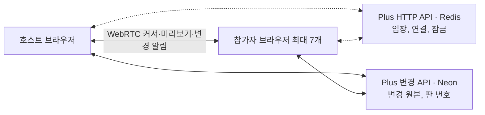

# Plus Live 자동 P2P 상세설계

2026-11-25

## 보드 입장

로그인한 사용자가 기존 Plus 주소에서 협업 보드(`collab_flg = 1`, `delta` 모드)를 열면 자동으로 Live에 입장한다. 보드 목록의 **Live** 표시와 기존 멤버 권한을 적용한다. 연결을 위한 새 URL이나 호스트의 입장 승인 조작 없이, 현재 세션과 보드 ID로 바로 입장한다.

- 먼저 입장한 편집 권한자의 브라우저가 호스트가 된다. 공동 편집자도 소유자 없이 호스트가 될 수 있다.
- 호스트 포함 최대 8개 브라우저 자리를 허용한다. 보기 권한만 있는 로그인 사용자도 자기 권한으로 입장하며, 정원이 찬 브라우저는 그 상태를 표시하고 재시도한다.
- 편집자가 아직 없으면 참가자는 보드를 조회하며 연결을 기다린다. 호스트가 떠나면 남은 편집자 중 먼저 들어온 브라우저가 자동으로 이어받는다.
- 일반 보드와 비로그인 공개 보드 조회에는 자동 Live 연결을 시작하지 않는다. [Plus 보드 진입](../../apps/plus/hooks/useBoardSync.ts) · [권한 규칙](../../apps/plus/lib/board-permissions.ts)

## 연결과 저장

| 영역 | 코드와 역할 |
| --- | --- |
| 보드 화면 | 기존 보드 주소, `useBoardSync`, `LiveRuntime`, 공통 협업 UI를 사용한다. |
| WebRTC | 공통 `DirectWebRtc`가 STUN 설정과 SDP 처리를 담당한다. Plus의 `PeerTopology`는 승인된 호스트와 최대 7개 직접 연결을 관리한다. 전송할 메시지 종류는 Plus가 정한다. |
| HTTP·Redis | 자리를 예약하고 호스트를 선출한다. 호스트와 참가자 사이에 SDP를 전달하고, 잠금과 마지막 판 번호를 조회한다. |
| Neon | 최종 보드 상태와 변경 기록을 보관한다. 편집 요청은 작성자의 계정과 보드 권한으로 검증한다. |

## 입장 API와 호스트 교체

| 요청 | 동작 |
| --- | --- |
| `POST /api/boards/:id/live/token` | 로그인 쿠키로 보드 읽기 권한을 확인한다. `clientId`, `leaseId`로 방 자리를 열거나 갱신하고, 자기 방 상태와 60초짜리 서명 토큰을 반환한다. |
| `POST /api/boards/:id/live` · `pulse` | 방 토큰으로 자리를 확인하고 25초 동안 갱신한다. 현재 호스트, 접속자, 잠금, 최신 판 번호와 자기 양쪽 연결 정보만 돌려준다. |
| 같은 주소 · `acquire` / `release` | 해당 좌석으로 잠금의 획득·해제를 요청한다. 잠금 획득에는 편집 권한이 필요하다. |
| 같은 주소 · `leave` | 해당 접속 세대의 자리만 반납한다. |

정원, 호스트, 연결 시도는 방별 Redis 키 `mdr:peer-room:<boardId>`에서 원자적으로 갱신한다. 호스트가 바뀌면 새 `epoch`를 발급하고 기존 연결 시도와 후보를 폐기한다. 새 SDP는 현재 호스트와 대상 참가자만 읽을 수 있다. 연결되면 SDP와 후보를 지운다. 협상은 시도당 최대 25초다.

평소에는 5초 간격으로 자리를 갱신하고, 연결을 협상할 때는 더 짧게 확인한다. 약 45초마다 기존 계정과 권한을 조회해 토큰을 갱신한다. 명시적으로 나가거나 브라우저 갱신이 끊겨 자리가 만료되면 남은 편집자가 이어받는다. 참가자는 같은 보드에서 새 호스트에게 자동으로 연결된다. [방 상태와 선출](../../apps/plus/lib/live/p2p/rooms.ts) · [연결 관리](../../apps/plus/lib/live/p2p/room-client.ts)

## 실시간 이벤트와 저장

WebRTC는 커서, 끌기 미리보기, 상태 갱신 신호를 전달한다. 호스트는 전달할 프레임에 연결된 사용자의 ID를 붙인다. 브라우저는 현재 입장한 사용자와 서버가 승인한 잠금의 미리보기만 표시한다. 소유자·관리자·공유 멤버에게 보이는 이메일 범위는 기존 규칙을 따른다. 공개 보드의 로그인 비멤버에게는 서버가 이메일을 가린다.

1. 브라우저가 잠금이 필요한 카드의 키로 인증된 HTTP 잠금을 요청한다.
2. 편집자는 자기 계정으로 기존 `POST /changes`를 호출한다. 서버가 겹치는 잠금과 변경 충돌을 판정하고 Neon에서 변경을 확정한다.
3. 편집자의 브라우저는 확정 뒤 WebRTC로 갱신 신호를 보낸다. 각 참가자가 HTTP에서 서버의 최신 판 번호를 확인하고 `GET /changes?after=R`로 변경과 필요한 이미지를 받는다.
4. 알림을 놓쳤으면 다음 방 상태 확인에서 빠진 판을 받는다. 토큰 갱신 시 Neon의 최신 판을 한 번 더 확인한다. 이력 보존 범위를 지났을 때는 기존 재동기화 안내를 사용한다. [기존 변경분 저장 흐름](./change-sync.md)

잠금은 Redis에서 키 단위로 20초 동안 유지된다. 실제로 보유한 잠금이 있을 때 입장 갱신과 함께 연장한다. 사용자가 놓은 키는 로컬 저장·전송을 마친 후 해제한다. 연결이 만료되어 응답을 보내지 못하면 TTL로 해제된다. 로그인 계정과 권한은 커밋 때 다시 확인되며, 충돌 감지는 Neon의 판 번호와 변경 키 기록을 사용한다. [잠금 저장소](../../apps/plus/lib/live/store/redis-store.ts)

직접 연결이 지연되면 Live 상태를 표시하고 기존 클라우드 편집으로 돌아간다. 뒤에서 같은 주소의 연결을 재시도한다. 화면 입력이 10분 동안 없으면 자리를 비우고, 다시 입력하면 같은 보드에서 재입장한다. STUN으로 직접 경로를 찾고, TURN을 쓰지 않는 환경에서는 공유기나 방화벽 제약으로 직접 연결이 제한될 수 있다. [WebRTC 연결 가이드](https://webrtc.org/getting-started/peer-connections)

## 개발과 운영 설정

| 변수 | 용도 |
| --- | --- |
| `LIVE_ENABLED=true` | Plus 협업 보드의 자동 Live 연결 활성화 |
| `REDIS_URL` | 운영 Plus의 방 상태와 잠금 저장소. 개발에서 비우면 Next 프로세스의 메모리를 사용한다. |
| `LIVE_TOKEN_SECRET` | 운영에서 Live 자리 토큰에 서명하는 서버 비밀 값 |
| `LIVE_ALLOWED_ORIGINS` | 외부 프록시 등에서 필요한 추가 웹 출처 목록 |
| `NEXT_PUBLIC_PEER_LIVE_STUN_URLS` | STUN 주소 목록. 생략하면 기본 STUN을 사용한다. |
| `CRON_SECRET` | 기존 변경 로그 정리 Cron 인증 |

로컬에서 Plus Live를 켜려면 `apps/plus/.env.local`에 `LIVE_ENABLED=true`를 넣고 루트에서 `npm run dev`를 실행한다. 기존 Plus 보드를 HTTPS 또는 localhost에서 연다. 같은 출처의 HTTP 경로를 사용하므로 Free 도메인 프록시를 통해 여는 Plus 보드도 같은 입장 흐름을 쓴다.

운영에서는 기존 Plus HTTP API와 Redis·Neon 사용량이 발생한다. Live WebSocket 업그레이드, 지속 연결 인스턴스, TURN 트래픽은 이 구현의 사용량에 포함되지 않는다. 배포 때 기존 보드를 열어 둔 브라우저는 새로고침하면 새 클라이언트의 자동 입장 경로를 사용한다.

브라우저 검증은 `npm run test:e2e:live --workspace=meldrift-plus`로 실행한다. PGlite와 실제 HTTP 라우트를 통해 기존 주소 자동 입장, 공동 편집자의 호스팅, 호스트 퇴장 후 승계, 키 잠금, 지속 저장을 확인한다.
